# py-analyze-common

A utility library shared by analyze-loudness / analyze-spectrum.

## Documentation languages

- **Override of the global CLAUDE.md's 「ドキュメント」 language rule**: this file is written entirely in English, and the README and the auto-update document are maintained in both English and Japanese (`README.md` and `README.ja.md`, `docs/auto-update.md` and `docs/auto-update.ja.md`, kept section for section)

## Project structure

```mermaid
graph LR
    root["py-analyze-common/"]
    root --> gh_dep[".github/dependabot.yml<br>version updates every day at 00:00 JST of the SHA-pinned actions (github-actions)<br>and of the yt-dlp pin in pyproject.toml (uv)"]
    root --> gh_cc[".github/codecov.yml<br>Codecov posts its statuses once the three uploads of a commit have arrived (after_n_builds)"]
    root --> ght[".github/tests/"]
    ght --> ght_am["dependabot-auto-merge-test.sh<br>test that dependabot-auto-merge.yml runs on every PR, with only its steps limited to Dependabot PRs,<br>and of which updates and commits (their authors, how many, whether the last is the head, who committed it,<br>whether its signature is verified) its step schedules or turns off an auto-merge for, with a fake gh"]
    root --> wf[".github/workflows/"]
    wf --> wf_ci["ci.yml<br>pytest with coverage on Ubuntu and macOS on PRs and on pushes to main<br>(required checks test and test-macos of main), and tests/test_tempdirs.py on Windows;<br>the job coverage uploads the three coverage.xml reports to Codecov once all of them exist<br>(codecov/project, which Codecov reports from them, is a required check of main)"]
    wf --> wf_amt["dependabot-auto-merge-test.yml<br>runs .github/tests/dependabot-auto-merge-test.sh on PRs and pushes to main that change it or dependabot-auto-merge.yml"]
    wf --> wf_am["dependabot-auto-merge.yml<br>enables auto-merge on a Dependabot PR that is one commit at the head, written by Dependabot alone,<br>committed by GitHub (web-flow) and with a verified signature, for an update of the Python dependencies (uv)<br>or of a submodule, and for a semver patch or minor update of a GitHub Action (required check auto-merge of main)"]
    root --> r_claude["CLAUDE.md"]
    root --> r_readme["README.md<br>English"]
    root --> r_readme_ja["README.ja.md<br>Japanese"]
    root --> r_lic["LICENSE"]
    root --> r_pyproj["pyproject.toml"]
    root --> docs["docs/"]
    docs --> d_up["auto-update.md<br>English: how an update runs, what is verified, the signing key"]
    docs --> d_up_ja["auto-update.ja.md<br>Japanese"]
    root --> src["src/analyze_common/"]
    src --> s_init["__init__.py<br>public API (__all__), __version__"]
    src --> s_plat["platform.py<br>IS_WINDOWS / IS_MAC / IS_LINUX / IS_FROZEN, subprocess_kwargs(), find_executable()"]
    src --> s_theme["theme.py<br>is_dark_mode(): OS-native dark mode detection"]
    src --> s_ff["ffmpeg.py<br>ffmpeg_kwargs(), run_ffmpeg(), probe_info()"]
    src --> s_dl["download.py<br>download_audio(), sanitize_filename(), compute_middle(), is_url()"]
    src --> s_prog["programs.py<br>start_program(): starting a program that ends with this process (for ffmpeg and download)"]
    src --> s_json["json_util.py<br>json_safe()"]
    src --> s_upd["update.py<br>auto-update client (UpdateConfig, Updater, hold_instance_mutex)"]
    src --> s_ed["ed25519.py<br>Ed25519 signature verification (RFC 8032, pure Python)"]
    src --> s_man["update_manifest.py<br>for CI: creating and signing latest.json (python -m analyze_common.update_manifest)"]
    src --> s_ffr["ffmpeg_release.py<br>for build.py (analyze_common.build): reading, writing and fetching the bundled ffmpeg pin<br>(build_assets/ffmpeg.json), detecting new builds (python -m analyze_common.ffmpeg_release)"]
    src --> s_net["network.py<br>HTTPS fetching whose failed connection names every address it tried (for ffmpeg_release, update and build)"]
    src --> s_build["build.py<br>the consumer's build (App, main()): bundled assets, PyInstaller, Inno Setup / DMG;<br>the consumer's build.py passes its names"]
    src --> s_icons["icons.py<br>icon.ico / icon.png / icon.iconset from the consumer's build_assets/icon_draft.svg<br>(python -m analyze_common.icons)"]
    src --> s_server["server.py<br>GuiServer, the limits CACHE_MAX_ENTRIES and MAX_TRACKS, and GuiHandler: the GUI servers' shared request handling (Host / Content-Type checks, /common/*, /browse,<br>/save-image, /settings, /update/*, JSON and NDJSON answers), ClientDisconnected"]
    src --> s_win["window.py<br>process setup for one OS: set_app_user_model_id() (Windows), run_atexit_on_app_quit() (macOS)"]
    src --> s_tmp["tempdirs.py<br>InstanceLock, sweep_orphan_tempdirs(): which instances of a program run,<br>and the sweep of the temp folders a killed one left behind"]
    src --> s_set["settings.py<br>SettingsStore, settings_dir(): per-OS user settings file (JSON)"]
    src --> s_ui["ui_settings.py<br>UiSettings: theme and language settings (value validation, window background color,<br>script handed to the page), show_window_color_until_paint()"]
    src --> s_test["testing/<br>tests the consumers run on their own repository (configure() from the consumer's conftest.py)"]
    s_test --> s_test_init["__init__.py<br>configure()"]
    s_test --> s_test_rw["release_workflow.py<br>release.yaml and requirements/*.txt"]
    s_test --> s_test_tpl["third_party_licenses.py<br>the GPL texts THIRD_PARTY_LICENSES.txt names and their bundling"]
    s_test --> s_test_ejs["yt_dlp_ejs.py<br>the installed yt-dlp-ejs is the one the installed yt-dlp accepts"]
    s_test --> s_test_font["chart_font.py<br>the consumer's canvas text takes its font family from CHART_FONT_FAMILY"]
    src --> web["web/"]
    web --> w_init["__init__.py<br>WEB_DIR, COMMON_CSS, UPDATE_JS, SETTINGS_JS, I18N_JS, BOOT_JS, UI_JS"]
    web --> w_css["common.css<br>CSS shared by both GUIs (shared variables + shared components)"]
    web --> w_set["settings.js<br>shared by both GUIs: receiving and saving the stored theme and language (window.analyzeSettings)"]
    web --> w_i18n["i18n.js<br>shared by both GUIs: window.analyzeI18n.install(DICT), which sets window.i18n<br>(t / tr / lang / setLang / onChange / applyStatic)"]
    web --> w_boot["boot.js<br>shared by both GUIs: the theme and the language on the html element before the CSS paints"]
    web --> w_ui["ui.js<br>shared by both GUIs: the fonts of canvas text, the most tracks of a comparison, icons, the theme toggle's drawing,<br>the input bar's button icons, the comparison queue's rows, the result title row, tooltips,<br>reserved button widths, the drop overlay's text, the status area's error line"]
    web --> w_upd["update.js<br>shared by both GUIs: settings button, settings dialog, update check flow"]
    root --> inst["installer/"]
    inst --> inst_iss["auto_update.iss<br>Inno Setup include (waiting and relaunching for an installer started by auto-update)"]
    root --> t["tests/"]
    t --> t_conf["conftest.py<br>Ed25519 test signer, local HTTP server, executable files for find_executable(),<br>faked name resolution and connecting, a program whose writes show that it runs"]
    t --> t_dl["test_download.py"]
    t --> t_ed["test_ed25519.py"]
    t --> t_ff["test_ffmpeg.py"]
    t --> t_json["test_json_util.py"]
    t --> t_plat["test_platform.py"]
    t --> t_prog["test_programs.py<br>a program started around the atexit functions, with both ways to start one<br>and, on macOS, a real terminate:"]
    t --> t_set["test_settings.py"]
    t --> t_theme["test_theme.py"]
    t --> t_ui["test_ui_settings.py"]
    t --> t_upd["test_update.py"]
    t --> t_man["test_update_manifest.py<br>needs openssl (skipped without it)"]
    t --> t_ffr["test_ffmpeg_release.py<br>the osxexperts.net page and the BtbN listing are fixtures, zips come from a local HTTP server"]
    t --> t_net["test_network.py<br>also checks that no other module calls urllib's urlopen / urlretrieve / HTTPSHandler<br>or http.client's HTTPSConnection directly"]
    t --> t_build["test_build.py<br>the names App derives, the version and mutex read from the package,<br>the Inno Setup / create-dmg arguments, the steps each flag runs"]
    t --> t_icons["test_icons.py<br>the sizes and files icons.py renders (resvg-py and Pillow faked)"]
    t --> t_server["test_server.py<br>GuiHandler on a local server with a fake consumer state"]
    t --> t_win["test_window.py<br>the Windows process setup with faked ctypes; the macOS Quit with faked Cocoa modules<br>and, on macOS, a real terminate:"]
    t --> t_tmp["test_tempdirs.py<br>the lock of a running instance across real processes, and the sweep that reads it"]
    t --> t_web["test_web.py"]
```



## Public API

`__all__` is the single source. Only the following are public:

| Symbol | Module | Description |
|--------|--------|-------------|
| `IS_WINDOWS` | platform | `sys.platform == "win32"` |
| `IS_MAC` | platform | `sys.platform == "darwin"` |
| `IS_LINUX` | platform | `sys.platform.startswith("linux")` |
| `IS_FROZEN` | platform | PyInstaller frozen build detection |
| `subprocess_kwargs()` | platform | per-OS subprocess argument dict (Windows: hidden console, macOS frozen: DYLD_* restored) |
| `find_executable()` | platform | absolute path of a program found in the absolute entries of PATH (Windows: `name.exe`, others: an executable `name`), or `None` |
| `SettingsStore` | settings | reading and writing settings kept in one JSON file (a broken file is read as the defaults with a warning, a write replaces the file from a temporary file) |
| `settings_dir()` | settings | per-product user settings folder (Windows: `%APPDATA%`, macOS: `~/Library/Application Support`, others: `$XDG_CONFIG_HOME` or `~/.config`) |
| `UiSettings` | ui_settings | reading and writing the theme (`theme`) and language (`lang`) kept in `SettingsStore` (`values()` / `update()`), the window's background color (`background_color()`), the body of `/common/settings.js` (`script()`) |
| `show_window_color_until_paint()` | ui_settings | macOS: shows the pywebview window's `background_color` until the page paints (removes WKWebView's white background) |
| `is_dark_mode()` | theme | OS dark mode detection (Win: registry, macOS: defaults, Linux: gsettings/kreadconfig5) |
| `ffmpeg_kwargs()` | ffmpeg | subprocess_kwargs() + LC_ALL=C (for ffmpeg/ffprobe) |
| `run_ffmpeg()` | ffmpeg | `subprocess.run()` (`check`, `capture_output`, `timeout` and `Popen`'s arguments) for a program that is killed when the atexit functions run |
| `probe_info()` | ffmpeg | gets (channels, duration_sec) with ffprobe (started by the path `find_executable()` gives) |
| `download_audio()` | download | audio download with the yt-dlp Python API (ffmpeg and deno passed to yt-dlp by the paths `find_executable()` gives) |
| `sanitize_filename()` | download | file name sanitization (control characters + Windows reserved names) |
| `compute_middle()` | download | computes the start point and length of the middle extraction; `None` for both when the whole source is used |
| `is_url()` | download | HTTP(S) URL check |
| `json_safe()` | json_util | recursive NaN/Infinity → None conversion |
| `UpdateConfig` | update | per-app auto-update identity (product name, repository, current version, public key, temporary directory prefix, mutex name) |
| `Updater` | update | `status()` / `check()` / `install(version)`. `install` returns a `Handoff` |
| `Handoff` | update | how the app ends after the update is applied (`exit_mode`: `"close"` / `"immediate"` / `None`) |
| `UpdateError` | update | a failure to check, download, verify or apply |
| `hold_instance_mutex()` | update | Windows: holds the named mutex the installer waits for |
| `COMMON_CSS` | web | path of the shared CSS that both GUIs load before `style.css` |
| `UPDATE_JS` | web | path of the settings dialog and update check UI that both GUIs serve as `/common/update.js` |
| `SETTINGS_JS` | web | path of the script that receives and saves the theme and language, which `UiSettings.script()` appends after the stored values |
| `I18N_JS` | web | path of the translation script both GUIs serve as `/common/i18n.js` and load before their own `i18n.js` (the dictionary) |
| `BOOT_JS` | web | path of the script both GUIs serve as `/common/boot.js` and load in `<head>` after their `i18n.js`: the theme and the language on `<html>` before the CSS paints |
| `UI_JS` | web | path of the UI helpers both GUIs serve as `/common/ui.js` and load before their `main.js` |
| `GuiHandler` | server | the GUI server's request handler the consumer's handler extends ([GUI server](#gui-server-server)) |
| `GuiServer` | server | the GUI's HTTP server: a `ThreadingHTTPServer` whose listen backlog holds the connections a webview opens while loading a page |
| `CACHE_MAX_ENTRIES` | server | how many results each result cache of the consumer's GUI holds |
| `MAX_TRACKS` | server | how many tracks a comparison in the consumer's GUI holds (`window.MAX_TRACKS` in `web/ui.js` is a mirror, and `tests/test_web.py` checks that they match) |
| `ClientDisconnected` | server | raised by `GuiHandler._send_event()` when the client closed the connection during an NDJSON stream |
| `set_app_user_model_id()` | window | Windows: sets the process's AppUserModelID (the taskbar shows the EXE's icon) |
| `run_atexit_on_app_quit()` | window | macOS: runs the atexit functions when the app quits through `terminate:` (the Quit menu item, Cmd+Q, logging out) |
| `InstanceLock` | tempdirs | marks this process as a running instance of a program until `release()`, the end of a `with` block or the end of the process |
| `sweep_orphan_tempdirs()` | tempdirs | removes the temp folders a killed process left behind, unless another instance of the program runs |
| `__version__` | — | SemVer string |

## Usage

Placed at `vendor/py-analyze-common` as a git submodule. The consumer's `__init__.py` does `sys.path.insert(0, vendor/py-analyze-common/src)` and imports it. Not listed in pyproject.toml.

## Tests

```bash
python3 -m venv .venv
.venv/bin/pip install -e . pytest pytest-cov
.venv/bin/python -m pytest -q
.venv/bin/python -m pytest -q --cov --cov-report=term-missing  # with line and branch coverage of src/analyze_common, without testing/, which the consumers' tests run ([tool.coverage.run] in pyproject.toml)
```

`tests/` reads `analyze_common` with a normal import, so `pip install -e .` (or `PYTHONPATH=src`) is needed. `test_update_manifest.py` skips when the `openssl` on PATH cannot create Ed25519 keys (the LibreSSL 3.3 that ships with macOS cannot; put Homebrew's `openssl@3` first on PATH). macOS-only tests (`hdiutil` / `renamex_np` / `ps`) skip on other OSes, and the tests of a real `terminate:` in `test_window.py` and `test_programs.py` also skip without `pyobjc-framework-Cocoa`, which CI installs on macOS.

CI (`.github/workflows/ci.yml`) runs on PRs and on pushes to main: its matrix runs on Ubuntu 24.04 (`test`) and macOS 26 (`test-macos`) with `fail-fast: false`. Each installs `pip install -e . pytest pytest-cov` on Python 3.12, runs `python -m pytest -q --cov --cov-report=xml` and hands `coverage.xml` to the job `coverage` as an artifact. The checks `test` and `test-macos` are required checks of main. The job `test-tempdirs-windows` runs `tests/test_tempdirs.py` on Windows Server 2025 and hands its report over in the same way; it is not a required check of main. Once all three reports exist, `coverage` uploads each to Codecov with `codecov/codecov-action`, and `.github/codecov.yml` sets `codecov.notify.after_n_builds: 3`, so Codecov posts its statuses from all three reports rather than from the ones that arrived first; Codecov combines the uploads for the same commit. The job's `id-token: write` lets the uploads authenticate with GitHub's OIDC token (`use_oidc: true`), so the repository holds no Codecov token. On a pull request a failed upload fails `coverage` (`fail_ci_if_error: true`); on a push to main the step's `continue-on-error` leaves the run green (.github/workflows/ci.yml:128). `codecov/project` is a required check of main, reported by Codecov (app id 254) once the three uploads have arrived; `codecov/patch` is not. The artifacts hand the reports over within one run and are kept for a day: within it, re-running the failed `coverage` job reuses them, and after it, re-running all jobs makes them again.

## Design decisions

### subprocess_kwargs() returns a new dict every time

Restoring DYLD_* in a frozen build depends on a snapshot of the environment variables at that moment, so the result cannot be cached.

### Programs start by absolute path (find_executable)

On Windows, `subprocess` hands a bare program name to `CreateProcess`, which searches the directory of the executable, then the current directory, then the system directories, and `PATH` last ([CreateProcessW](https://learn.microsoft.com/en-us/windows/win32/api/processthreadsapi/nf-processthreadsapi-createprocessw)). yt-dlp's lookup of deno on Windows also checks the current directory before `PATH` (`yt_dlp/utils/_jsruntime.py` `_find_exe()`).

- `find_executable(name)` searches only the absolute entries of `PATH`, in order. On Windows it matches `name + ".exe"` only (the extension `CreateProcess` appends to a bare name; `.bat` / `.cmd` would run through `cmd.exe`); elsewhere the file must be executable
- `probe_info()` runs that path for ffprobe. `download_audio()` passes it to yt-dlp as `ffmpeg_location` (yt-dlp takes the ffprobe in the same folder) and as `js_runtimes={"deno": {"path": ...}}`
- ffprobe not found: `probe_info()` raises `FileNotFoundError` without starting a process. ffmpeg not found: `download_audio()` raises `FileNotFoundError` without calling yt-dlp. deno not found: `js_runtimes={}` (yt-dlp runs with no JavaScript runtime)

### ffmpeg ends with the app (run_ffmpeg)

The consumers run their analysis's ffmpeg through `run_ffmpeg()`, and `download_audio()` does the same for what yt-dlp starts: every program yt-dlp runs (ffmpeg, ffprobe, deno) goes through `yt_dlp.utils.Popen`, whose `__init__` is wrapped on the first call. Both start through `programs.start_program()`, which keeps each process in a `WeakSet` that one atexit function kills, so closing the app during an analysis, or quitting it with `run_atexit_on_app_quit()` in place, stops the program. It does not cover `probe_info()`, which reads a file's header with a 30-second limit.

- A start and the kill run one at a time under one lock: a program being started when the kill comes is killed as soon as its start returns, and after the kill a start raises `RuntimeError` without starting anything
- The kill is registered at the first start, and `atexit` runs the functions last in, first out, so it comes before the removal of the temp folders the consumer registered earlier. A function registered while the atexit functions run does not run, so the kill is also registered when the module loads, for a first program started in that time

### Temp folders a killed process left behind (tempdirs)

A process that is killed leaves its temp folders. The consumer's GUI removes them when it ends, with `sweep_orphan_tempdirs(prefix, lock, keep)` in an atexit function, where `keep` holds its own folders. The consumer's GUI holds an `InstanceLock(prefix)` while it runs, and its CLI holds one while its work folder exists.

- The lock is `flock` on macOS and Linux and `msvcrt.locking` on Windows, on a file `<prefix>instance_*.lock` in the temp folder. The operating system ends it with the process, however the process ends, and a pid is not used: a pid can come back on another process, and on Windows `os.kill(pid, 0)` sends `CTRL_C_EVENT`. The programs the process starts do not inherit the file. `tests/test_tempdirs.py` holds it in real processes and ends them with a kill, on Windows too
- While another instance runs the sweep removes nothing, so a folder of any kind stays while an instance may use it: the cache, dropped files, an analysis's work folder, an update's folders. One sweep is skipped when another instance is running at that moment, and the next process to end does it
- A lock file counts as running when another process holds its lock, when it cannot be opened, or when it is 5 seconds old or newer (its process may not have locked it yet)
- When the file system takes no locks (`ENOTSUP`, `EOPNOTSUPP`), a lock file counts as running until it is 24 hours old (`_NO_LOCKS_RUNNING_SEC`). The sweep then goes on, so an instance that has run longer than that on such a file system loses a folder that has not changed for an hour
- Any other error of a lock (`ENOLCK`, for one) counts as running, however old the file is
- `InstanceLock()` writes one line to stderr when it cannot lock its file, and goes on
- The sweep removes a lock file it can lock, which is what a killed process leaves. `release()` removes the process's own
- Without another instance, the sweep removes only `prefix*` folders that have not changed for an hour (`ORPHAN_MIN_AGE_SEC`), so the folders of a process that starts during the sweep stay

### Dark mode detection priority (Linux)

1. GNOME `color-scheme` (GNOME 42+)
2. GNOME `gtk-theme` (GNOME <42 fallback)
3. KDE `kreadconfig5` (True if the value contains "dark")
4. All of the above fail → `False`

subprocess runs with `LC_ALL=C`, which avoids substring match failures caused by locale-dependent translations ("Dunkel" etc.).

### sanitize_filename() adopts the spectrum version (the strict version)

Removes the control characters 0x00-0x1F explicitly. The loudness version did not include `\x00-\x1f`, but yt-dlp metadata can contain control characters, and this prevents `open()` from failing with `ValueError('embedded null byte')`.

### compute_middle()

The message is plain text without a prefix (`[info]` etc.). Each consumer controls the display format.

When the source is no longer than the minutes asked for, the start and the length are `None`. The consumer passes them to ffmpeg, which then has no `-ss` and no `-t` and reads to the end of the source. The total the function receives comes from ffprobe, which estimates it from the bit rate for a VBR MP3 without a Xing header and can come out shorter than the source.

### Auto-update

How an update runs, what the user sees, what is verified, how each OS applies it and the signing key are in `docs/auto-update.md` (Japanese: `docs/auto-update.ja.md`). The consumers' documents point there.

The consumer puts `PUBLIC_KEY` and `UPDATE_CONFIG` in `src/<pkg>/update.py`, gets `/update/status` / `/update/settings` / `/update/check` / `/update/install` on the GUI server from `GuiHandler`, and `window.analyzeUpdate.init({appName, isBusy, setBusy, setStatus, showError})` in the frontend. Its `main()` holds `hold_instance_mutex(UPDATE_CONFIG.mutex_name)`, and its `exit_for_update(exit_mode)` ends the app for the `Handoff`.

- `launch_check()` / `set_launch_check()` read and write the "Check at launch" setting, and `status()` returns it as `launch_check`
- The strings of `web/update.js` (en / ja) are held by update.js and follow `window.i18n.lang()` and `onChange`. They are not put in the dictionary of the consumer's i18n.js

### Window icon

PyInstaller's `EXE(icon=...)` is only the icon of the EXE file itself (shown in Explorer). The pywebview window icon (title bar and taskbar) needs an explicit `webview.start(icon=...)` (moved from `create_window` to `start` in pywebview 6.x). The consumer bundles `build_assets/icon.ico` through PyInstaller's `datas` and resolves it through `_ICON_PATH`.

The `icon=` argument is passed only on Windows (`sys.platform == "win32"`). On macOS the Dock/app icon comes from the `.app` bundle (`CFBundleIconFile` = `icon.icns`); passing `icon=` there makes pywebview's Cocoa backend call `NSApplication.setApplicationIconImage_`, which overrides the bundle icon with the raw `icon.ico` bitmap. That bitmap carries no icon-grid inset, so on macOS 26 the Dock renders it edge-to-edge (oversized) instead of at the system-masked size the bundle icon gets.

The Windows taskbar groups processes by AppUserModelID. When it is not set, the Python runtime's default ID is used and the icon embedded in the EXE does not show on the taskbar. The consumer's `main()` sets its own ID with `set_app_user_model_id()`.

### Theme and language settings

The consumer creates exactly one `SettingsStore` and passes it to both `Updater(config, store)` and `UiSettings(store)`, so both read and write the same file under the same lock. The GUI server returns `UiSettings.script()` for GET `/common/settings.js` with `Cache-Control: no-store`, and calls `UiSettings.update()` for POST `/settings` (`ValueError` is 400, `OSError` is 500). pywebview's `background_color` gets `UiSettings.background_color()`. The page loads `common/settings.js` in the `<head>` of `index.html` before `common/i18n.js` and its own `i18n.js`, starts drawing with `window.analyzeSettings.theme` / `.lang`, and saves with `window.analyzeSettings.save(name, value)` on every switch. The consumer owns how a failed save is shown.

- Keys: `theme` (`light` / `dark` / `auto`; `auto` when missing or for any other value) and `lang` (`en` / `ja`; `null` when missing or for any other value, and the page follows the OS language). `update()` accepts only one at a time
- `script()` prepends `window.analyzeSettingsStored = {...};` to `web/settings.js`. Only values that passed the read validation are included, so rewriting the settings file does not deliver arbitrary strings to the page
- `save()` waits for the previous save's response before sending the next one. The consumer's server (`ThreadingHTTPServer`) handles requests concurrently, so when they are sent back to back, a value chosen later can be written first and then be overwritten by the earlier value
- `BG_LIGHT` / `BG_DARK` mirror `--bg` in `web/common.css` (`:root` and `[data-theme="dark"]`), and `tests/test_ui_settings.py` checks that they match
- The consumer calls `show_window_color_until_paint(window)` right after `webview.create_window()`. pywebview (6.2.1) on macOS attaches WKWebView to the window when the first load finishes, and WKWebView draws a white background until its first paint. `background_color` applies only to the window, so `drawsBackground` of WKWebView is turned off in `events.before_show`, and the window's color shows until the page paints. Windows' WebView2 uses `background_color` as its own background (`DefaultBackgroundColor`), so nothing is done there. WKWebView is touched only on pywebview whose `before_show` runs on the main thread (5.4 and later; `Event(self, True)`). On pywebview without `before_show` (before 5.3) it returns without registering, and on pywebview whose handler runs on another thread (5.3) it changes nothing. In both cases, and when it cannot turn the background off, it writes to stderr and the window opens as is (the consumers' `pyproject.toml` also allow pywebview before 5.3)

### GUI server (server)

The consumer's `AnalyzeHandler` extends `GuiHandler`: it sets `frontend_dir`, `save_image_name`, `_AUDIO_TYPES` and, when they differ from 10 MB / 50 MB, `_MAX_BODY` / `_MAX_IMAGE_BODY`; returns its state from `updater()`, `ui_settings()`, `window()`, `dialog_lock()` and `exit_for_update(exit_mode)`; and its `do_POST` routes `_shared_handlers()` (`/save-image`, `/browse`, `/settings`, `/update/*`) together with its own endpoints. The state is read through these methods on every request, so a consumer that keeps it in module globals (and tests that replace them) needs nothing more.

- `do_GET` serves `/common/settings.js` (`UiSettings.script()`, `Cache-Control: no-store`), the files of `web/` at `/common/*`, and `frontend_dir`. Every request is refused with 403 unless its Host is `127.0.0.1` or `localhost`, and `_check_content_type()` answers 415 unless a POST is `application/json` (`application/octet-stream` for `/upload`)
- `_read_json_body()` returns `None` for a body that is not JSON or is larger than the limit, and `{}` for an empty one
- `_send_event()` writes one NDJSON line with NaN / Infinity as `null`; when the client has gone, it prints the traceback and raises `ClientDisconnected`
- `finish()` ends the response, then reads what the client still sends until it closes or `_LINGER_SEC` passes. A handler can answer before the request body it does not read has arrived (`/browse`, `/update/status`, `/update/check`, the consumers' `/load`, and any refused request). A body that reaches a closed socket resets the connection, which can take the response from a client that has not read it yet
- `window.py`: `run_atexit_on_app_quit()` does nothing outside macOS; the consumer calls it from `main()`. pywebview's Quit menu item has the action `terminate:`, and AppKit ends the process with C's `exit()`, so the interpreter does not finish and neither the atexit functions nor the finalizers of a `TemporaryDirectory` run; closing the last window returns from `webview.start()` and they do run. The function observes `NSApplicationWillTerminateNotification` and calls `atexit._run_exitfuncs()`, which runs each function once. Before that it arms `faulthandler.dump_traceback_later(_QUIT_LIMIT_SEC, file=2, exit=True)`, whose thread needs no GIL: a process still running at the limit, in an atexit function or in C's `exit()`, writes every thread's stack to file descriptor 2 and ends with exit code 1. `tests/test_window.py` runs a real `terminate:` on macOS, with and without it, and stalled in each of those places
- `window.py`: `set_app_user_model_id()` does nothing outside Windows; the consumer calls it from `main()`. WebView2's `AllowExternalDrop` (whether files can be dropped into it) is left at its default, true, so the page's drop handler receives dropped files; pywebview (6.2.1) itself turns off WebView2's swipe navigation

### Shared frontend scripts (web)

The consumer's `index.html` loads, in `<head>`: `common/settings.js`, `common/i18n.js`, its own `i18n.js` (which calls `window.analyzeI18n.install(DICT)`), `common/boot.js`, then `common/common.css` before its `style.css`; and at the end of `<body>`: `common/ui.js` and `common/update.js` before its `main.js`. `ui.js` is a classic script whose functions (`_createIcon()`, `_applyThemeMode()`, `_applyButtonIcons()`, `_createTrackRow()`, `_replaceTrackRows()`, `_redrawKeepingFocus()`, `_afterResize()`, `_createTitleRow()`, `_addTip()`, `_reserveButtonWidth()`, `_classButtonWidth()`, `_renderError()` and the others) are globals that `main.js` calls; it reads `window.i18n` and the i18n keys `theme.title.*`, `theme.aria_state.*`, `track.tag_*`, `track.move_up`, `track.move_down`, `track.remove`, `drop.overlay`, `err.prefix` and `btn.copy*` of the consumer's dictionary.

`common.css` gives every button and field (`button`, `input`, `select`, `textarea`) the page's font with `font-family: inherit`, instead of the engine's default control font.

A canvas does not take the page's font, so `ui.js` holds `CHART_FONT_FAMILY`, the families of the page's font in `common.css` in the same order (`tests/test_web.py` checks that they match). The consumers' charts and PNG export draw their text in it (`ctx.font = "10px " + CHART_FONT_FAMILY`), and their uPlot axes spread `CHART_AXIS_FONTS` into their options, which keeps uPlot's sizes. uPlot's legend is HTML text whose style sheet loads after `common.css` and names a font of its own, so `common.css` gives it the page's font with a selector of higher specificity (`body .uplot`). The consumer's chart scripts load before `ui.js` and read them when they draw. `analyze_common.testing.chart_font` fails when a consumer's script names a font of its own.

The input bar (`#browse-btn`, `#submit-btn`, `#add-btn`, `#load-btn`), the comparison queue (`#track-list`, filled with `_createTrackRow()`) and the compare bar (`#clear-btn`) look the same in both GUIs:

- `common.css` gives every button of the input bar and the compare bar its shape and a face by role: Browse and Clear All neutral (`--neutral-*`), Add Track green (`--add-*`), both defined here; Analyze and Load JSON from the consumer's `style.css` (`--primary-bg` / `--primary-bg-hover` / `--primary-fg`, `--load-bg` / `--load-bg-hover` / `--load-fg`), so each app keeps its accent. In the dark theme hover makes a face lighter. At 900 CSS px wide and narrower the bar wraps: the field takes a row of its own and the buttons share the row below it. The queue rows read `--track-bg`, `--track-tag-bg`, `--track-tag-fg` and `--track-remove` from `style.css`
- `_applyButtonIcons()` puts a folder icon on Browse and a document icon on Load JSON; their labels are `<span data-i18n>` inside the button, so the translation pass keeps the icon. `main.js` calls it before reserving the button widths. The icons appear when `main.js` runs, together with the theme toggle's icon. Chromium (WebView2) can paint the page before that, so on Windows the first frame can show these buttons without their icons
- `_createTrackRow(track, on)` makes one queue row: the track's color, its number, a tag of its kind (URL / FILE / JSON), its source, and the move up / move down / remove buttons (`.track-btn` with `data-action` up / down / remove; the slot of a move the row cannot make is a hidden placeholder). The consumer decides the kind of each source, puts the rows in with `_replaceTrackRows(list, rows, move)` (`move` is `{from, to}` after it swapped the tracks of those rows) and redraws them on a theme or language change. `_replaceTrackRows()` hands a focused row button's focus to the button with the same action in the row at the same position (the last row when the queue got shorter), or to that row's remove button when that action has no button there now. After a move the focus follows its track to the other row, and the row itself takes it when the same action has no button there (a move to the top or the bottom), so a further key press does nothing

The status area (`#status`) has the same rule in both GUIs: one line's height reserved, so the results start at the same place.

The result title row, the save buttons and the Copy button of an error line also look the same in both GUIs:

- `common.css` styles the date and source line under the row (`.meta-info`); a source link in it keeps the line's color
- `_createTitleRow(title)` makes the row (`.title-row`) with the title as an `h2.result-title`; the consumer appends its save buttons (`.save-btn`) after it. The title sits on the left and wraps when it is long, and the buttons sit on the right. The title color is `--result-title-fg` from the consumer's `style.css`
- `common.css` gives `.save-btn` the shape of the compare bar's buttons and the primary face (`--primary-*`), and `.copy-btn` (made by `_renderError()`) the same shape, outlined (`--copy-bg`, `--copy-bg-hover`, `--copy-border`, `--copy-fg`, defined here with the error line's `--error-bg`)

`_redrawKeepingFocus(container, redraw)` runs a redraw that rebuilds what is inside `container` (the consumers' `#results`, which has `tabindex="-1"`): when the focus was inside `container` and the redraw took it out, `container` takes it; focus anywhere else stays where it is. The page goes back to the scroll position it had in a microtask queued after the redraw: taking out the old content makes the page shorter than that position while the redraw runs, and a uPlot chart the redraw makes has its final height only in a microtask of its own, queued before that one.

`_afterResize(then)` runs `then()` 200 ms after the last of a run of calls; the consumers call it from their `resize` listener and redraw in `then()`. When an input or a textarea has the focus at the first call of the run, a redraw through `_redrawKeepingFocus()` in `then()` goes back to the scroll position the page had at that call: in WKWebView (macOS), a change of the window's width while the URL field has the focus moves the page to the top before `then()` runs. Until then the page also goes back to that position on each `scroll` event, so a scroll during the run, the user's included, does not stay. The position is dropped when `then()` returns, whether it redrew or not.

### Fetching over HTTPS (network)

`ffmpeg_release._read()`, `update._open()` and the downloads of `build.py` make their HTTPS connections through `network` (`urlopen()`, or `HTTPSHandler` in an opener of their own).

- `connect()` tries the host's addresses in the order `getaddrinfo` returns them, each with the fetch's timeout and with the address as `getaddrinfo` gives it (an IPv6 scope id included), as `socket.create_connection` does. When every address fails, it raises `ConnectError`, an `OSError` that names each address with its own error (`could not connect to HOST port PORT (ADDRESS: ERROR; ...)`); `socket.create_connection` reports the last address's error only. urllib hands it on as the `reason` of a `URLError`
- `HTTPSHandler` is `urllib.request.HTTPSHandler` whose connections connect with `connect()`; TLS still checks the certificate against the host name. Plain `http://` goes through urllib's own handler
- `tests/test_network.py` fails when another module of the package calls `urllib.request.urlopen` / `urlretrieve` / `HTTPSHandler` or `http.client.HTTPSConnection` directly

### Building a consumer (build)

The consumer's `build.py` puts `vendor/py-analyze-common/src` on `sys.path`, makes `App(root, package, display_name, uplot_version)` and calls `main(App)`; the command line (`--installer` / `--skip-download` / `--skip-build` / `--update-checksums` / `--ffmpeg-only`) is the same for both consumers, and their workflows call `python build.py`.

- `App` derives every per-app name from the package and the display name: the spec and the PyInstaller COLLECT directory (`analyze-loudness`), the `.app` and the DMG volume (`Loudness Analyzer`), the DMG file (`Loudness-Analyzer.dmg`)
- `_read_version()` / `_read_mutex_name()` read `__version__` and `UPDATE_CONFIG`'s `mutex_name` from `src/<package>/`; `_build_inno()` passes them to Inno Setup as `/DMyAppVersion=` / `/DMyAppMutex=`
- The bundled ffmpeg is handled by `ffmpeg_release` ([Bundled ffmpeg pin](#bundled-ffmpeg-pin-ffmpeg_release)); uPlot is checked against the consumer's `build_assets/checksums.json`; deno and the Windows ffmpeg are not pinned
- `check_prerequisites()` stops the build without PyInstaller, without certifi (PyInstaller only warns when it is missing) or without the binaries in `build_assets/bin`
- macOS is Apple Silicon (arm64) only (since v1.3.0 of the consumers; Intel Mac support ended with v1.2.0). ffmpeg / ffprobe are osxexperts.net's arm64 native builds. evermeet.cx (x86_64) is not used because (a) an Intel Mach-O in the bundle makes macOS 26 show the warning that support for apps for Intel processors is ending, and (b) connections from the GitHub Actions macos runner time out

### Tests the consumers share (testing)

`analyze_common/testing/` holds tests that check a consumer's own repository and environment, not this package: the consumer's `tests/conftest.py` calls `testing.configure(root, package)`, and a one-line test file of the consumer (`from analyze_common.testing.release_workflow import *`) has pytest collect them as the consumer's tests. A module reads `testing.app()` when it is imported, so `configure()` has to run in `conftest.py`. The modules' names do not start with `test_`, so this repository's own pytest does not collect them (they need a consumer's repository, and `yt_dlp_ejs` needs yt-dlp-ejs).

### Bundled ffmpeg pin (ffmpeg_release)

The consumer has `build_assets/ffmpeg.json` (`{"series", "macos_arm64": {"ffmpeg" | "ffprobe": {"url", "sha256"}}}`): the series of ffmpeg / ffprobe bundled on both OSes (`series`, e.g. `8.1`), and the URL and SHA256 of the macOS build. `build.py` (`analyze_common.build`, which the consumer's `build.py` runs) calls `load_pin()` / `btbn_asset()` / `fetch_macos_binary()`.

- macOS: `build.py` fetches the osxexperts.net zip and checks the binaries in it against the pinned SHA256 (a mismatch stops the build)
- Windows: the build of the same series in `latest` of BtbN/FFmpeg-Builds. Its contents change daily, so the SHA256 is not pinned. When the series disappears from `latest`, the build stops
- Updates: the consumer's `.github/workflows/ffmpeg-watch.yml` does this daily and carries it through to a patch release ([Patch release for an ffmpeg update](#patch-release-for-an-ffmpeg-update)). The osxexperts.net URL is not derived from the version (`ffmpeg81arm.zip` / `ffmpeg9arm.zip`), so the pin is taken from the page's links. To do it by hand, the following command, run in the consumer, only when the page has a different build, confirms that BtbN has the same series and that both files match the page's SHA256, then writes the new pin to `--candidate`. When `pin_update=true`, copy its contents to `build_assets/ffmpeg.json`

  ```bash
  PYTHONPATH=vendor/py-analyze-common/src .venv/bin/python -m analyze_common.ffmpeg_release detect \
    --pin build_assets/ffmpeg.json --version-file src/<package>/__init__.py --candidate <tmpdir>/ffmpeg.json
  ```

- Verification: the consumer's `tests/test_ffmpeg_binary.py` runs the ffmpeg / ffprobe on PATH through the app's own code; its section "Bundled ffmpeg pin" says what it compares. Given the directory of the bundled binaries in `EXPECT_FFMPEG_DIR`, it confirms the ffmpeg / ffprobe there are found first, with `find_executable()`, and fails instead of skipping when they are not. The release build (`.github/workflows/release.yaml`) runs this test on the copies inside the distributables (on Windows `dist/<app>/_internal/bin` collected by PyInstaller, on macOS `Contents/Frameworks/bin` of the `.app` after signing), and on failure it does not proceed to uploading the artifacts and creating the Draft Release. `analyze_common.testing.release_workflow` checks the position of that step and the directory it passes against the spec and `installer.iss`
- The osxexperts.net page (`parse_osxexperts()`): for each "Download ffmpeg X.Y (Apple Silicon)" or "Download ffmpeg X.Y.Z (Apple Silicon)" link, reads the "SHA256 checksum of ... file : <hex>" found before the next download link. Fails unless there is exactly one Apple Silicon build each of ffmpeg / ffprobe, with the same full version (`MAJOR.MINOR` or `MAJOR.MINOR.PATCH`), and the link is a zip under `https://www.osxexperts.net/`. The pin's `series` is the `MAJOR.MINOR` part for BtbN; each macOS URL and digest is kept as the page lists it. ffplay and the Intel builds are not read
- The SHA256 is the value of the binary inside, not of the zip (the same value the page lists)
- BtbN (`btbn_asset()`): `ffmpeg-n{series}-latest-win64-gpl-{series}.zip` in `releases/tags/latest`. Fails when it is absent (lgpl builds are not used)
- `detect` (CLI): only when the pin and the page differ, it checks the BtbN series, downloads both files, checks them against the page's SHA256, and writes the new pin to `--candidate`. Whether a patch release is needed (`bump`) is `true` when `__version__` equals the latest `vX.Y.Z` tag and either the pin changes this time or the current pin differs from the pin that tag released. The pin a tag released (`released_pin()`) is the pin in the pin file at the tag, or, when the tag has none, the pin of the first commit after the tag that added the file. When neither exists, the latter comparison is not made
- `release_sha` of `detect`: when `__version__` is `MAJOR.MINOR.PATCH` and there is no `v{version}` tag, the commit in HEAD's first-parent history that introduced that version (`pending_release()`). The consumer's `ffmpeg-watch.yml` uses it to resume from the state where the version bump was merged but no tag was created, by passing that commit to `tag-release.yml`. Empty otherwise
- Exit status of `detect`: 3 when no address of a host it fetches from accepted the connection (`network.ConnectError`, on its own or as the `reason` of a `URLError`), 1 on any other failure (a timeout or an error after the connection included), 0 otherwise. The consumer's `ffmpeg-watch.yml` runs detect again on another runner on 3 ([Patch release for an ffmpeg update](#patch-release-for-an-ffmpeg-update))
- Fetching (`_read()`: the page, the BtbN listing and the downloads) goes through `network.urlopen()` ([Fetching over HTTPS](#fetching-over-https-network))
- Importing `analyze_common` makes `__init__.py` load yt-dlp, so running the CLI needs the consumer's dependencies (`pip install -e .`)

### yt-dlp version pin

`pyproject.toml` has an exact-match pin `yt-dlp==<version>`. The `pyproject.toml` of the consumers (analyze-loudness / analyze-spectrum) have the same pin, and a manual version bump updates all three at the same time. A Dependabot update of the Python dependencies (the `uv` entry of each repository's `.github/dependabot.yml`, every day at 00:00 JST, for a version released at least three days before) is merged automatically here and in the consumers at any semver level once its required checks pass, unless someone other than Dependabot pushed a commit to its PR (`.github/workflows/dependabot-auto-merge.yml`); each repository merges its own, so the three values may not match until all three have. Dependabot moves yt-dlp and `yt-dlp-ejs` (the challenge solver scripts yt-dlp reads) in one pull request in the consumers (the `yt-dlp` group), and their `tests/test_yt_dlp_ejs.py` fails when the two disagree. In the consumers the checks pass only when the update also keeps `requirements/release.txt` in step with `pyproject.toml` ([Pinned release dependencies](#pinned-release-dependencies)). What goes into a consumer's shipped build is the pin in the consumer's `pyproject.toml`; this `pyproject.toml` is not used by the consumers' builds (the submodule is read through `sys.path` injection).

Why pin: the shipped app has yt-dlp baked into the PYZ by PyInstaller, so it cannot be updated after installation. Leaving it unpinned makes the version depend on the resolution at build time, and the version inside a shipped app cannot be identified afterwards.

Check the pinned version before opening a consumer's version bump PR ([Release procedure](#release-procedure)). A pin changed by a Dependabot auto-merge reached master without this check:

1. In a `.venv` with the version pinned in the consumer's `pyproject.toml`, confirm a **full-length download**. `--test` (fetches only the first 10 KiB) cannot detect a 403:
   `.venv/bin/python -m yt_dlp -f bestaudio -o "<tmpdir>/%(id)s.%(ext)s" "<URL>"`
   Confirm with three kinds: a normal video, a live archive and a Short
2. If it fails, install a candidate version with `pip install -U yt-dlp`, run the same check, and write the version that passes into the three `pyproject.toml` files. Commit py-analyze-common first, then update the submodule pointer. In the consumers, regenerate `requirements/*.txt` in the same commit as the `pyproject.toml` change ([Pinned release dependencies](#pinned-release-dependencies))

## Releasing a consumer

Each consumer's CLAUDE.md names only its own files. `master` below is the consumer's default branch.

### Release procedure

Before opening the version bump PR, check the pinned yt-dlp version with a full-length download ([yt-dlp version pin](#yt-dlp-version-pin)).

1. Open a PR that raises `__version__` in `src/<package>/__init__.py` (a version bump contains no other change)
2. After the merge, when the CI run of the push to master succeeds, `.github/workflows/tag-release.yml` detects the change of `__version__`, puts a `vX.Y.Z` tag on the merge commit, and starts `.github/workflows/release.yaml` with `workflow_dispatch` on that tag
3. `release.yaml` builds the Windows installer and the macOS DMG and creates the Release (`draft: true`) together with the signed `latest.json` (`docs/auto-update.md`). Before uploading the artifacts, the build runs the ffmpeg / ffprobe inside the distributables through `tests/test_ffmpeg_binary.py` ("Verification" in [Bundled ffmpeg pin](#bundled-ffmpeg-pin-ffmpeg_release))
4. A person publishes the Release. The published Release becomes `releases/latest`, and the update check of installed apps reads its `latest.json` (a prerelease does not become `latest`, so it does not show up)

The merge of the version bump PR is the starting point of a release. `tag-release.yml` does nothing on a push that does not change `__version__`, and does not move a tag of the same name that already exists on another commit. `tag-release.yml`'s `workflow_dispatch` handles the commit of the input `sha`, and tags it only when it is on master and CI succeeded on that commit or on a parent commit with the same tree (the head of a PR merged with the tip of master included). `release.yaml` also builds and releases on a tag push and on a `workflow_dispatch` on a tag (a `workflow_dispatch` on a branch only builds).

### Pinned release dependencies

Dependabot updates `pyobjc-core` and `pyobjc-framework-*` together in the `pyobjc` group of the consumer's `.github/dependabot.yml`.

The release jobs install nothing that is resolved at build time:

- Python packages: `requirements/release.txt` (the dependencies of `pyproject.toml` and its `gui` and `dev` extras), installed with `--require-hashes --no-deps --no-build-isolation` after `requirements/release-build.txt` (the pip that installs it, and the build backends of its source distributions and of the project). The `sign-manifest` job installs only `requirements/sign-manifest.txt` (yt-dlp, which analyze_common imports) as a wheel
- Build tools: Inno Setup (Windows) and create-dmg (macOS) are downloaded from their GitHub releases and checked against the SHA256 in `release.yaml` (`INNOSETUP_SHA256`, `CREATE_DMG_SHA256`)
- Not pinned: deno and the Windows ffmpeg / ffprobe, which `build.py` downloads ([Bundled ffmpeg pin](#bundled-ffmpeg-pin-ffmpeg_release))

`requirements/*.txt` are generated by uv from `pyproject.toml` and `requirements/*.in` (uv is in the `dev` extra of `pyproject.toml`). Run the following from the consumer's root after changing the dependencies of `pyproject.toml` (the yt-dlp pin included); add `--upgrade` to the first command to take newer versions:

```bash
uv pip compile pyproject.toml --extra gui --extra dev --universal --python-version 3.12 --generate-hashes -o requirements/release.txt
uv pip compile requirements/release-build.in -c requirements/release.txt --universal --python-version 3.12 --generate-hashes -o requirements/release-build.txt
uv pip compile requirements/sign-manifest.in -c requirements/release.txt --universal --python-version 3.12 --generate-hashes -o requirements/sign-manifest.txt
```

`--python-version` is the `python-version` of `release.yaml`. The consumer's `tests/test_release_workflow.py` fails when `requirements/release.txt` does not satisfy `pyproject.toml`, when a file was generated with other options, or when uv finds no resolution for the command in a file's header with that file's own pins as constraints (a pin that breaks the requirement of another package in the file) or finds one with a package the file does not pin, or pins under another environment marker (the release jobs install with `--no-deps`, so it would be missing on that platform), or without one the file pins, so a branch that changes `pyproject.toml` without regenerating these files does not pass CI, whoever opened it.

### Patch release for an ffmpeg update

The consumer's `.github/workflows/ffmpeg-watch.yml` does the following daily (and on `workflow_dispatch`), with no human step until the Draft Release is created. The bot merges the PRs without review.

1. detect: checks out the current tip of master when the job starts, including its tags and history, then compares `build_assets/ffmpeg.json` with the osxexperts.net page ([Bundled ffmpeg pin](#bundled-ffmpeg-pin-ffmpeg_release)). When the page has a different build, it confirms that BtbN has the same series and checks the SHA256 of both files, and makes a new pin. It makes a patch release when `__version__` equals the latest `vX.Y.Z` tag and either the pin changes this time or the current pin differs from the pin that tag released (the pin file in the tag, or, when the tag has none, the pin from when the file was first added after the tag)
2. smoke: checks out the exact commit recorded by detect, then on macOS and Windows runners, runs `tests/test_ffmpeg_binary.py` on the binaries fetched with `build.py --ffmpeg-only` using the pin from that commit, replaced by the candidate artifact when `pin_update=true`
3. land: opens in order the pin PR (`ffmpeg-watch/pin-<series>-<run id>-<attempt>`) and the bump-only PR (`ffmpeg-watch/bump-v<version>-<run id>-<attempt>`, `chore: update the version to vX.Y.Z`), pushing, opening and merging them with the GitHub App's token (the prerequisite below) and reading the PRs and runs with GITHUB_TOKEN. Each PR starts its CI (`Test 🧪`) and `dependabot-auto-merge.yml` (`auto-merge`) runs of `pull_request` and its `workflow-checks.yml` (`action-pins`) run of `pull_request_target`; land merges the PR after the three runs on its head commit succeed and `gh pr checks --required` passes. The merge of the bump runs the CI of the push to master, which starts `tag-release.yml` (step 2 of the [Release procedure](#release-procedure)). GITHUB_TOKEN is not used for these PRs: a PR it opens starts no `pull_request_target` run and its `pull_request` runs wait for an approval, and the checks of runs started with `workflow_dispatch` are not counted as the required checks of master's ruleset (the merge of such a PR was refused with `3 of 3 required status checks are expected.`)
4. A person publishes the Release (step 4 of the [Release procedure](#release-procedure))

- Prerequisite: a GitHub App installed on the consumer's repository with the repository permissions Contents (read and write) and Pull requests (read and write), its client ID in the repository variable `FFMPEG_WATCH_APP_CLIENT_ID`, and its private key (the contents of the `.pem`) in the repository secret `FFMPEG_WATCH_APP_PRIVATE_KEY`. The token land creates carries only those two permissions. Without the variable or the secret, land fails at its first step
- When a PR from an earlier run (an open PR whose head is `ffmpeg-watch/`) remains, land fails without changing anything. Close or merge that PR, then run again. The branch name differs per run (run id and attempt), so a branch pushed by a run that failed before opening its PR does not collide with the next run's push (that branch stays without a PR). When only the pin PR was merged and the bump remains, the next run's detect resumes from the bump, as "the current pin differs from the pin the latest tag released". When the bump was merged but there is no tag (for example, the CI run of that push failed), the next run's detect reports the master commit that set `__version__` to that value (`release_sha`), and land passes that commit and starts `tag-release.yml`. If the tag already exists, it does nothing
- When smoke, or any of the runs of a PR (CI, auto-merge, action-pins), fails, or a run does not start within three minutes, land stops at that point and does not merge
- When detect exits 3 (no address of a host accepted the connection, [Bundled ffmpeg pin](#bundled-ffmpeg-pin-ffmpeg_release)), the detect job passes with a warning and the job `retry` dispatches `ffmpeg-watch.yml` on master with the input `detect_attempt` one higher, which runs detect on another runner; when attempt 3 exits 3, detect fails the run. A runner that cannot connect to www.osxexperts.net stays unable to for minutes while other runners connect: in this repository's probe run 42483121856, 6 of 40 Ubuntu runners failed their first connection, their reconnection from the same source port and their 96 reconnections from new ports over 240 seconds all failed, and the 6 connected to pypi.org 102 times out of 102

## Compatibility policy

SemVer. Symbols outside `__all__` are internal. See README.md for details.
