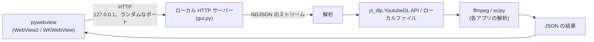
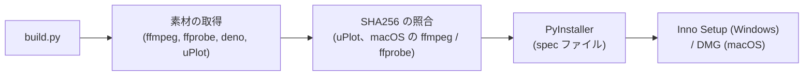

# Architecture of the analyze apps

> English version: [architecture.md](architecture.md)

analyze-loudness と analyze-spectrum (利用側) に共通すること — デスクトップアプリの作り、GUI のエンドポイントとストリームの応答の形、フロントエンド、ビルド、アクセシビリティの決まり — を書く。共有するコードはこのライブラリにある。モジュールの一覧は `AGENTS.md` (「Project structure」)、それぞれの動きは `AGENTS.md` (「Design decisions」)、セキュリティの対策は [security-model.ja.md](security-model.ja.md) にある。それぞれのアプリが何を解析するかは、そのアプリ自身の `docs/architecture.md` にある。

## Overall structure



2 つのアプリは、同じ作りのデスクトップアプリになっている。

- pywebview のネイティブのウィンドウ (Windows は WebView2、macOS は WKWebView)
- `127.0.0.1` で待ち受けるローカル HTTP サーバー。ポートは OS が選ぶ (port 0)
- 進み具合は、NDJSON (1 行に 1 つの JSON オブジェクトを並べた形式) のストリームから表示する
- 音声は、yt-dlp の Python API (`yt_dlp.YoutubeDL`) でダウンロードする
- ffmpeg と ffprobe は、subprocess として起動する

既定のウィンドウは、どちらのアプリも 1200 x 900。Analyze を押すと、入力欄の音源が待ち行列へ移り、1 行なら単体の解析、2 行以上なら比較になる。

どちらのアプリにもある機能: 比較 (`MAX_TRACKS` 本まで。値は 6)、ローカルファイルの解析 (パスの入力、ファイルのダイアログ、ファイルのドロップ)、セッションの間だけ残る結果のキャッシュ (一時フォルダー)、結果の JSON と画像の保存、自動更新 ([auto-update.ja.md](auto-update.ja.md))、テーマと言語の保存。

## GUI endpoints

| エンドポイント | Method | 両アプリに共通の動き |
|---|---|---|
| `/analyze` | POST | URL かローカルファイルを、そのアプリの解析に通す。応答は NDJSON のストリーム |
| `/save` | POST | 結果の JSON を、ネイティブのダイアログで保存する |
| `/save-image` | POST | base64 で送られた PNG を、ネイティブのダイアログで保存する |
| `/load` | POST | ネイティブのダイアログで JSON を選び、表示し直す |

どちらのアプリも、ほかに `/compare`・`/browse`・`/upload`・`/settings`・`/update/*`・`/common/*` を持つ。Host と Content-Type の検査、`/browse`・`/save-image`・`/settings`・`/update/*`・`/common/*` は、このライブラリの `GuiHandler` が持つ (`AGENTS.md`「GUI server (server)」)。アプリごとの全部の一覧は、それぞれの `CLAUDE.md` の「GUI endpoints」の節にある。

## NDJSON protocol

ストリームの応答は、1 行に 1 つの JSON オブジェクトで、どの行も `type` を持つ (`GuiHandler._send_event()`)。

```json
{"type":"progress","stage":"download","message":"..."}
{"type":"result","data":{}}
{"type":"error","error":"..."}
```

- `progress` は `stage` と `message` を持つ。アプリごとの stage、ほかの項目、ほかの種類のイベントは、それぞれの `CLAUDE.md` の「Response format (GUI NDJSON)」の節にある
- 検証に失敗した要求には、ストリームを始める前に、HTTP 400 と JSON の本文で答える。ストリームを始めた後のエラーは、HTTP 200 の応答の中の `error` イベントになる。ヘッダーを送った後は、ステータスを変えられないため
- ストリームには `Content-Length` が無く、chunked でもない。終わりは `Connection: close` で決まる

## Frontend

共有のスクリプトとスタイルシート、ページがそれらを読み込む順、それぞれの関数の動きは、`AGENTS.md` (「Shared frontend scripts (web)」「Theme and language settings」) にある。

### Charts

| 描く道具 | 使う所 |
|---|---|
| uPlot (各アプリの `frontend/vendor/`) | 時系列と周波数のチャート (analyze-loudness の timeline、analyze-spectrum の spectrum) |
| Canvas 2D | そのほかのチャート (analyze-loudness のヒストグラムとセグメントのバー。analyze-spectrum の 1/3 オクターブバンド、transfer function、low-end と mid-high のチャート) |

それぞれのアプリは、チャートの色を 1 か所で持つ (analyze-loudness は `frontend/theme.js` の `getTheme()`、analyze-spectrum は `frontend/main.js` の `getThemeColors()`)。テーマが変わると、チャートを描き直す。

### Theme

テーマは、`[data-theme="dark"]` の下の CSS 変数で切り替える。共有の変数は `common.css`、アプリごとの変数はそれぞれの `frontend/style.css` にあり、どちらのファイルも 2 つのテーマに同じ名前を定義する。ツールバーのテーマのボタンは、light、dark、auto の順に切り替わって light に戻る。`auto` は OS の `prefers-color-scheme` に従う。

- `<head>` で読み込む `common/boot.js` が、最初の描画の前に `<html>` の `data-theme` と `lang` を決めるので、ページが別のテーマで描き始まることが無い
- アクセントの色は、analyze-loudness が紫 (`#9C27B0`)、analyze-spectrum が青 (`#1565C0`)
- アイコンは、`common/ui.js` の `_createIcon()` が作る SVG

### Translation (English / Japanese)

それぞれのアプリの `frontend/i18n.js` が、辞書を `window.analyzeI18n.install(DICT)` (`common/i18n.js`) に渡し、`window.i18n` (`t`・`tr`・`lang`・`setLang`・`onChange`・`applyStatic`) ができる。

- 言語は、保存した設定があればその値、無ければ `navigator.language` で決まる (`ja` で始まれば日本語、それ以外は英語)
- 静的なテキストは `data-i18n` の属性 (`data-i18n`・`data-i18n-title`・`data-i18n-placeholder`・`data-i18n-aria-label`) で辞書を引く。スクリプトが作るテキストは `window.i18n.t(key)` を通す
- アプリの名前は、`ja` の辞書でも英語のままにする

### Toolbar

```html
<div class="toolbar"> <!-- </main> の後ろ。右上に固定 -->
  <button id="lang-toggle" class="lang-toggle"></button>
  <button id="theme-toggle" class="theme-toggle"></button>
  <!-- 設定のボタンは common/update.js が足す -->
</div>
```

### Shared components

寸法と色の正は `common.css`。部品を作る関数は `common/ui.js` にある。

- 入力欄のボタン (`.input-bar button`): 高さ 44px 以上、padding 10px 24px
- 比較バーと結果欄のボタン (`.compare-bar button`・`.save-btn`・`.copy-btn`): 高さ 36px 以上、padding 6px 20px
- ツールバーのボタン (`.lang-toggle`・`.theme-toggle`): 高さ 44px 以上、角丸 22px
- 無効のボタン: opacity 0.5、`cursor: not-allowed`
- Cancel になっている間の Analyze のボタン (`.cancelling`): `--danger` / `--danger-fg`
- フォーカスリング: `outline: 2px solid var(--focus-ring); outline-offset: 2px`
- `h1` (それぞれの `style.css`): padding 0 120px、font-size 1.6rem (幅 480px 以下では 1.2rem)
- ページのフォント: `-apple-system, "Segoe UI", "Meiryo", system-ui, sans-serif`

## Build



- それぞれのアプリの `build.py` は、自分の名前をこのライブラリの `analyze_common.build` に渡す (`AGENTS.md`「Building a consumer (build)」)
- yt-dlp は Python の依存で、PyInstaller が同梱する
- spec ファイルは、プロジェクトのルートをカレントディレクトリから取る。ビルドは、アプリのルートで走らせる
- macOS: `_build_icns_macos()` が、`.app` の bundle に入れる `icon.icns` を `icon.iconset` から作る
- 同梱するソフトウェアのライセンスは、それぞれのアプリの `THIRD_PARTY_LICENSES.txt` にある

## Accessibility

### Reduced motion

```css
@media (prefers-reduced-motion: reduce) {
  *, *::before, *::after {
    animation-duration: 0.001ms !important;
    animation-iteration-count: 1 !important;
    transition: none !important;
    scroll-behavior: auto !important;
  }
}
```

### Tooltips

`common/ui.js` の `_addTip()` が、要素にクラス `.has-tip` と `tabindex="0"` を付ける。`_showTip()` と `_hideTip()` が、`.tip-popup` を一度に 1 つだけ出したり消したりする。

- ポップアップは `role="tooltip"` を持ち、`aria-describedby` で元の要素と結び付く
- `mouseenter` と `focus` で出し、`mouseleave` と `blur` で消す
- Escape で消える (それぞれの `main.js` の `keydown` のハンドラー。かな漢字変換などの入力の途中は何もしない)

### Error line

`common/ui.js` の `_renderError()` が、アイコン (`aria-hidden`)、テキスト、Copy のボタン (クリップボードが使えるときだけ) を作る。ステータスの要素には `role="alert"` と `aria-live="assertive"` が付く。色は `common.css` の `--error` / `--error-bg` で、左に `--error` の 4px の線が付く。

### Landmarks

どのページも `<header><h1>...</h1></header><main>...</main>` を持つ。ツールバーは `</main>` の後ろに置くので、最初の Tab は入力欄へ行く。
