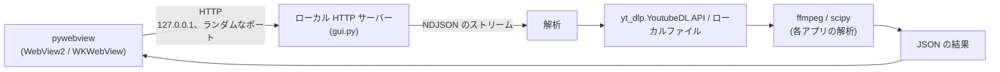
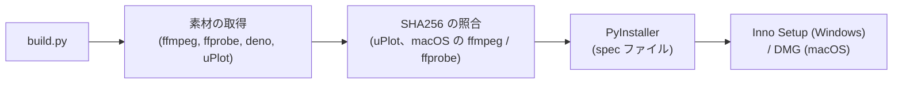

# Architecture of the analyze apps

> English version: [architecture.md](architecture.md)

analyze-loudness と analyze-spectrum (利用側) に共通すること — デスクトップアプリの作り、GUI のエンドポイントとストリームの応答の形、フロントエンド、ビルド、アクセシビリティの決まり — を書く。共有するコードはこのライブラリにある。ファイルの一覧は [Project structure](#project-structure)、公開している名前は [Public API](#public-api)、モジュールの動きは [How the modules work](#how-the-modules-work) と `AGENTS.md` (「Design decisions」)、セキュリティの対策は [security-model.ja.md](security-model.ja.md) にある。それぞれのアプリが何を解析するかは、そのアプリ自身の `docs/architecture.md` にある。

## Overall structure



2 つのアプリは、同じ作りのデスクトップアプリになっている。

- pywebview のネイティブのウィンドウ (Windows は WebView2、macOS は WKWebView)
- `127.0.0.1` で待ち受けるローカル HTTP サーバー。ポートは OS が選ぶ (port 0)
- 進み具合は、NDJSON (1 行に 1 つの JSON オブジェクトを並べた形式) のストリームから表示する
- 音声は、yt-dlp の Python API (`yt_dlp.YoutubeDL`) でダウンロードする
- ffmpeg と ffprobe は、subprocess として起動する

既定のウィンドウは、どちらのアプリも 1200 x 900。Analyze を押すと、入力欄の音源が待ち行列へ移り、1 行なら単体の解析、2 行以上なら比較になる。

どちらのアプリにもある機能: 比較 (`MAX_TRACKS` 本まで。値は 6)、ローカルファイルの解析 (パスの入力、ファイルのダイアログ、ファイルのドロップ)、セッションの間だけ残る結果のキャッシュ (一時フォルダー)、結果の JSON と画像の保存、自動更新 ([auto-update.ja.md](auto-update.ja.md))、テーマと言語の保存。

## GUI endpoints

| エンドポイント | Method | 両アプリに共通の動き |
|---|---|---|
| `/analyze` | POST | URL かローカルファイルを、そのアプリの解析に通す。応答は NDJSON のストリーム |
| `/save` | POST | 結果の JSON を、ネイティブのダイアログで保存する |
| `/save-image` | POST | base64 で送られた PNG を、ネイティブのダイアログで保存する |
| `/load` | POST | ネイティブのダイアログで JSON を選び、表示し直す |

どちらのアプリも、ほかに `/compare`・`/browse`・`/upload`・`/settings`・`/update/*`・`/common/*` を持つ。Host と Content-Type の検査、`/browse`・`/save-image`・`/settings`・`/update/*`・`/common/*` は、このライブラリの `GuiHandler` が持つ ([GUI server (server)](#gui-server-server))。アプリごとの全部の一覧は、それぞれの `AGENTS.md` の「GUI endpoints」の節にある。

## NDJSON protocol

ストリームの応答は、1 行に 1 つの JSON オブジェクトで、どの行も `type` を持つ (`GuiHandler._send_event()`)。

```json
{"type":"progress","stage":"download","message":"..."}
{"type":"result","data":{}}
{"type":"error","error":"..."}
```

- `progress` は `stage` と `message` を持つ。アプリごとの stage、ほかの項目、ほかの種類のイベントは、それぞれの `AGENTS.md` の「Response format (GUI NDJSON)」の節にある
- 検証に失敗した要求には、ストリームを始める前に、HTTP 400 と JSON の本文で答える。ストリームを始めた後のエラーは、HTTP 200 の応答の中の `error` イベントになる。ヘッダーを送った後は、ステータスを変えられないため
- ストリームには `Content-Length` が無く、chunked でもない。終わりは `Connection: close` で決まる

## Frontend

共有のスクリプトとスタイルシート、ページがそれらを読み込む順、それぞれの関数の動きは、[Shared frontend scripts (web)](#shared-frontend-scripts-web) と `AGENTS.md` (「Theme and language settings」) にある。

### Charts

| 描く道具 | 使う所 |
|---|---|
| uPlot (各アプリの `frontend/vendor/`) | 時系列と周波数のチャート (analyze-loudness の timeline、analyze-spectrum の spectrum) |
| Canvas 2D | そのほかのチャート (analyze-loudness のヒストグラムとセグメントのバー。analyze-spectrum の 1/3 オクターブバンド、transfer function、low-end と mid-high のチャート) |

それぞれのアプリは、チャートの色を 1 か所で持つ (analyze-loudness は `frontend/theme.js` の `getTheme()`、analyze-spectrum は `frontend/main.js` の `getThemeColors()`)。テーマが変わると、チャートを描き直す。

### Theme

テーマは、`[data-theme="dark"]` の下の CSS 変数で切り替える。共有の変数は `common.css`、アプリごとの変数はそれぞれの `frontend/style.css` にあり、どちらのファイルも 2 つのテーマに同じ名前を定義する。ツールバーのテーマのボタンは、light、dark、auto の順に切り替わって light に戻る。`auto` は OS の `prefers-color-scheme` に従う。

- `<head>` で読み込む `common/boot.js` が、最初の描画の前に `<html>` の `data-theme` と `lang` を決めるので、ページが別のテーマで描き始まることが無い
- アクセントの色は、analyze-loudness が紫 (`#9C27B0`)、analyze-spectrum が青 (`#1565C0`)
- アイコンは、`common/ui.js` の `_createIcon()` が作る SVG

### Translation (English / Japanese)

それぞれのアプリの `frontend/i18n.js` が、辞書を `window.analyzeI18n.install(DICT)` (`common/i18n.js`) に渡し、`window.i18n` (`t`・`tr`・`lang`・`setLang`・`onChange`・`applyStatic`) ができる。

- 言語は、保存した設定があればその値、無ければ `navigator.language` で決まる (`ja` で始まれば日本語、それ以外は英語)
- 静的なテキストは `data-i18n` の属性 (`data-i18n`・`data-i18n-title`・`data-i18n-placeholder`・`data-i18n-aria-label`) で辞書を引く。スクリプトが作るテキストは `window.i18n.t(key)` を通す
- アプリの名前は、`ja` の辞書でも英語のままにする

### Toolbar

```html
<div class="toolbar"> <!-- </main> の後ろ。右上に固定 -->
  <button id="lang-toggle" class="lang-toggle"></button>
  <button id="theme-toggle" class="theme-toggle"></button>
  <!-- 設定のボタンは common/update.js が足す -->
</div>
```

### Shared components

寸法と色の正は `common.css`。部品を作る関数は `common/ui.js` にある。

- 入力欄のボタン (`.input-bar button`): 高さ 44px 以上、padding 10px 24px
- 比較バーと結果欄のボタン (`.compare-bar button`・`.save-btn`・`.copy-btn`): 高さ 36px 以上、padding 6px 20px
- ツールバーのボタン (`.lang-toggle`・`.theme-toggle`): 高さ 44px 以上、角丸 22px
- 無効のボタン: opacity 0.5、`cursor: not-allowed`
- Cancel になっている間の Analyze のボタン (`.cancelling`): `--danger` / `--danger-fg`
- フォーカスリング: `outline: 2px solid var(--focus-ring); outline-offset: 2px`
- `h1` (それぞれの `style.css`): padding 0 120px、font-size 1.6rem (幅 480px 以下では 1.2rem)
- ページのフォント: `-apple-system, "Segoe UI", "Meiryo", system-ui, sans-serif`

## Build



- それぞれのアプリの `build.py` は、自分の名前をこのライブラリの `analyze_common.build` に渡す (`AGENTS.md`「Building a consumer (build)」)
- yt-dlp は Python の依存で、PyInstaller が同梱する
- spec ファイルは、プロジェクトのルートをカレントディレクトリから取る。ビルドは、アプリのルートで走らせる
- macOS: `_build_icns_macos()` が、`.app` の bundle に入れる `icon.icns` を `icon.iconset` から作る
- 同梱するソフトウェアのライセンスは、それぞれのアプリの `THIRD_PARTY_LICENSES.txt` にある

## Accessibility

### Reduced motion

```css
@media (prefers-reduced-motion: reduce) {
  *, *::before, *::after {
    animation-duration: 0.001ms !important;
    animation-iteration-count: 1 !important;
    transition: none !important;
    scroll-behavior: auto !important;
  }
}
```

### Tooltips

`common/ui.js` の `_addTip()` が、要素にクラス `.has-tip` と `tabindex="0"` を付ける。`_showTip()` と `_hideTip()` が、`.tip-popup` を一度に 1 つだけ出したり消したりする。

- ポップアップは `role="tooltip"` を持ち、`aria-describedby` で元の要素と結び付く
- `mouseenter` と `focus` で出し、`mouseleave` と `blur` で消す
- Escape で消える (それぞれの `main.js` の `keydown` のハンドラー。かな漢字変換などの入力の途中は何もしない)

### Error line

`common/ui.js` の `_renderError()` が、アイコン (`aria-hidden`)、テキスト、Copy のボタン (クリップボードが使えるときだけ) を作る。ステータスの要素には `role="alert"` と `aria-live="assertive"` が付く。色は `common.css` の `--error` / `--error-bg` で、左に `--error` の 4px の線が付く。

### Landmarks

どのページも `<header><h1>...</h1></header><main>...</main>` を持つ。ツールバーは `</main>` の後ろに置くので、最初の Tab は入力欄へ行く。

## Project structure

このリポジトリのファイル。

```mermaid
graph LR
    root["py-analyze-common/"]
    root --> gh_dep[".github/dependabot.yml<br>SHA で固定した actions (github-actions) と、<br>pyproject.toml の yt-dlp の固定値 (uv) の、毎日 00:00 JST の version update"]
    root --> gh_cc[".github/codecov.yml<br>Codecov は、1 つのコミットの 3 つのアップロードが届いてからステータスを出す (after_n_builds)"]
    root --> ght[".github/tests/"]
    ght --> ght_am["dependabot-auto-merge-test.sh<br>dependabot-auto-merge.yml がどのプルリクエストでも走り、ステップだけが Dependabot のプルリクエストに限られること、<br>そのステップがどの更新とコミット (作者、数、最後のコミットが head か、誰がコミットしたか、<br>署名が検証済みか) に自動マージを予約し、または外すかを、偽の gh で確かめるテスト"]
    root --> wf[".github/workflows/"]
    wf --> wf_ci["ci.yml<br>プルリクエストと main への push で、Ubuntu と macOS の pytest をカバレッジ付きで走らせ<br>(main の必須チェック test と test-macos)、Windows で tests/test_tempdirs.py を走らせる。<br>ジョブ coverage は、3 つの coverage.xml がそろってから Codecov へ送る<br>(Codecov がそれらから報告する codecov/project は main の必須チェック)"]
    wf --> wf_amt["dependabot-auto-merge-test.yml<br>そのスクリプトか dependabot-auto-merge.yml を変えるプルリクエストと main への push で、.github/tests/dependabot-auto-merge-test.sh を走らせる"]
    wf --> wf_am["dependabot-auto-merge.yml<br>head の 1 コミットだけで、Dependabot だけが書き、<br>GitHub (web-flow) がコミットし、署名が検証済みの Dependabot のプルリクエストに自動マージを有効にする。対象は Python の依存 (uv) の更新、<br>submodule の更新、GitHub Action の semver の patch と minor の更新 (main の必須チェック auto-merge)"]
    root --> r_claude["AGENTS.md"]
    root --> r_readme["README.md<br>英語"]
    root --> r_readme_ja["README.ja.md<br>日本語"]
    root --> r_lic["LICENSE"]
    root --> r_pyproj["pyproject.toml"]
    root --> docs["docs/"]
    docs --> d_up["auto-update.md<br>英語: 更新の流れ、検証するもの、署名の鍵"]
    docs --> d_up_ja["auto-update.ja.md<br>日本語"]
    docs --> d_dev["development.md<br>英語: 利用側を worktree からテストする、コミットごとのテストの走行、macOS で実アプリを probe する、<br>このライブラリの CI、ffmpeg の更新のパッチリリース"]
    docs --> d_dev_ja["development.ja.md<br>日本語"]
    docs --> d_dec["decisions/<br>閉じた判断: 何を選んだか、理由、却下した案、実害の記録。<br>どの記録も、英語の .md と日本語の .ja.md"]
    d_dec --> d_dec_up["auto-update.md, auto-update.ja.md<br>設定ダイアログのフォーカス、実機での確認"]
    d_dec --> d_dec_ci["ci-and-release.md, ci-and-release.ja.md<br>ワークフロー、Dependabot、リリースの経路"]
    d_dec --> d_dec_doc["documentation.md, documentation.ja.md<br>日本語版の見出し"]
    d_dec --> d_dec_gui["gui.md, gui.ja.md<br>2 つの利用側が共有する GUI"]
    d_dec --> d_dec_run["runtime.md, runtime.ja.md<br>Quit の見張り、版が混ざったときの一時フォルダー、接続の reset"]
    docs --> d_arch["architecture.md<br>英語: 2 つのアプリに共通すること (構造、GUI のエンドポイント、NDJSON、フロントエンド、ビルド、アクセシビリティ) と、<br>このライブラリのファイルの一覧、公開 API、モジュールの動き"]
    docs --> d_arch_ja["architecture.ja.md<br>日本語"]
    docs --> d_sec["security-model.md<br>英語: 入口、対策とそれぞれの実装場所、受け入れたリスク"]
    docs --> d_sec_ja["security-model.ja.md<br>日本語"]
    root --> src["src/analyze_common/"]
    src --> s_init["__init__.py<br>公開 API (__all__)、__version__"]
    src --> s_plat["platform.py<br>IS_WINDOWS / IS_MAC / IS_LINUX / IS_FROZEN、subprocess_kwargs()、find_executable()"]
    src --> s_theme["theme.py<br>is_dark_mode(): OS のダークモードの検出"]
    src --> s_ff["ffmpeg.py<br>ffmpeg_kwargs()、run_ffmpeg()、probe_info()"]
    src --> s_dl["download.py<br>download_audio()、sanitize_filename()、compute_middle()、is_url()"]
    src --> s_prog["programs.py<br>start_program(): このプロセスと一緒に終わるプログラムの起動 (ffmpeg と download のため)"]
    src --> s_json["json_util.py<br>json_safe()"]
    src --> s_upd["update.py<br>自動更新のクライアント (UpdateConfig、Updater、hold_instance_mutex)"]
    src --> s_ed["ed25519.py<br>Ed25519 の署名の検証 (RFC 8032、純 Python)"]
    src --> s_man["update_manifest.py<br>CI 用: latest.json の作成と署名 (python -m analyze_common.update_manifest)"]
    src --> s_ffr["ffmpeg_release.py<br>build.py (analyze_common.build) 用: 同梱する ffmpeg の固定値<br>(build_assets/ffmpeg.json) の読み書きと取得、新しいビルドの検出 (python -m analyze_common.ffmpeg_release)"]
    src --> s_net["network.py<br>接続に失敗したとき、試した全部のアドレスを示す HTTPS の取得 (ffmpeg_release、update、build のため)"]
    src --> s_build["build.py<br>利用側のビルド (App、main()): 同梱する素材、PyInstaller、Inno Setup / DMG。<br>利用側の build.py が自分の名前を渡す"]
    src --> s_icons["icons.py<br>利用側の build_assets/icon_draft.svg から icon.ico / icon.png / icon.iconset を作る<br>(python -m analyze_common.icons)"]
    src --> s_server["server.py<br>GuiServer、上限の CACHE_MAX_ENTRIES と MAX_TRACKS、GuiHandler: GUI のサーバーが共有するリクエストの処理 (Host / Content-Type の検査、/common/*、/browse、<br>/save-image、/settings、/update/*、JSON と NDJSON の応答)、ClientDisconnected"]
    src --> s_win["window.py<br>OS ごとのプロセスの設定: set_app_user_model_id() (Windows)、run_atexit_on_app_quit() (macOS)"]
    src --> s_tmp["tempdirs.py<br>InstanceLock、sweep_orphan_tempdirs(): プログラムのどのインスタンスが動いているかと、<br>強制終了されたインスタンスが残した一時フォルダーの掃除"]
    src --> s_set["settings.py<br>SettingsStore、settings_dir(): OS ごとのユーザー設定ファイル (JSON)"]
    src --> s_ui["ui_settings.py<br>UiSettings: テーマと言語の設定 (値の検証、ウィンドウの背景色、<br>ページへ渡すスクリプト)、show_window_color_until_paint()"]
    src --> s_test["testing/<br>利用側が自分のリポジトリに対して走らせるテスト (利用側の conftest.py から configure() を呼ぶ)"]
    s_test --> s_test_init["__init__.py<br>configure()"]
    s_test --> s_test_rw["release_workflow.py<br>release.yaml と requirements/*.txt"]
    s_test --> s_test_tpl["third_party_licenses.py<br>THIRD_PARTY_LICENSES.txt が挙げる GPL の全文と、その同梱"]
    s_test --> s_test_ejs["yt_dlp_ejs.py<br>入っている yt-dlp-ejs が、入っている yt-dlp の受け付けるものであること"]
    s_test --> s_test_font["chart_font.py<br>利用側の canvas の文字が、フォントファミリーを CHART_FONT_FAMILY から取ること"]
    src --> web["web/"]
    web --> w_init["__init__.py<br>WEB_DIR、COMMON_CSS、UPDATE_JS、SETTINGS_JS、I18N_JS、BOOT_JS、UI_JS"]
    web --> w_css["common.css<br>2 つの GUI が共有する CSS (共有の変数 + 共有の部品)"]
    web --> w_set["settings.js<br>2 つの GUI が共有: 保存したテーマと言語の受け取りと保存 (window.analyzeSettings)"]
    web --> w_i18n["i18n.js<br>2 つの GUI が共有: window.i18n を作る window.analyzeI18n.install(DICT)<br>(t / tr / lang / setLang / onChange / applyStatic)"]
    web --> w_boot["boot.js<br>2 つの GUI が共有: CSS が描く前に、テーマと言語を html 要素に付ける"]
    web --> w_ui["ui.js<br>2 つの GUI が共有: canvas の文字のフォント、比較のトラック数の上限、アイコン、テーマのボタンの描画、<br>入力欄のボタンのアイコン、比較の待ち行列の行、結果のタイトルの行、ツールチップ、<br>ボタンの幅の確保、ドロップのオーバーレイの文字、ステータス欄のエラーの行"]
    web --> w_upd["update.js<br>2 つの GUI が共有: 設定のボタン、設定ダイアログ、更新の確認の流れ"]
    root --> inst["installer/"]
    inst --> inst_iss["auto_update.iss<br>Inno Setup の include (自動更新が起動したインストーラーの、待ちと再起動)"]
    root --> t["tests/"]
    t --> t_conf["conftest.py<br>Ed25519 のテスト用の署名、ローカルの HTTP サーバー、find_executable() のための実行できるファイル、<br>偽の名前解決と接続、動いていることが書き込みで分かるプログラム"]
    t --> t_dl["test_download.py"]
    t --> t_ed["test_ed25519.py"]
    t --> t_ff["test_ffmpeg.py"]
    t --> t_json["test_json_util.py"]
    t --> t_plat["test_platform.py"]
    t --> t_prog["test_programs.py<br>atexit の関数の前後で起動するプログラム。起動の 2 つの経路の両方と、<br>macOS では実際の terminate:"]
    t --> t_set["test_settings.py"]
    t --> t_theme["test_theme.py"]
    t --> t_ui["test_ui_settings.py"]
    t --> t_upd["test_update.py"]
    t --> t_man["test_update_manifest.py<br>openssl が要る (無ければ skip)"]
    t --> t_ffr["test_ffmpeg_release.py<br>osxexperts.net のページと BtbN の一覧は fixture、zip はローカルの HTTP サーバーから来る"]
    t --> t_net["test_network.py<br>ほかのモジュールが urllib の urlopen / urlretrieve / HTTPSHandler と<br>http.client の HTTPSConnection を直接呼んでいないことも確かめる"]
    t --> t_build["test_build.py<br>App が導く名前、パッケージから読む版と mutex、<br>Inno Setup / create-dmg の引数、それぞれのフラグが走らせるステップ"]
    t --> t_icons["test_icons.py<br>icons.py が作る大きさとファイル (resvg-py と Pillow は偽物)"]
    t --> t_server["test_server.py<br>偽の利用側の状態を持つローカルのサーバーの上の GuiHandler"]
    t --> t_win["test_window.py<br>偽の ctypes での Windows のプロセスの設定。偽の Cocoa のモジュールでの macOS の Quit と、<br>macOS では実際の terminate:"]
    t --> t_tmp["test_tempdirs.py<br>動いているインスタンスのロックを実際のプロセスをまたいで確かめ、それを読む掃除も確かめる"]
    t --> t_web["test_web.py"]
```



## Public API

`__all__` が唯一の正。公開しているのは次のものだけ:

| シンボル | モジュール | 説明 |
|--------|--------|-------------|
| `IS_WINDOWS` | platform | `sys.platform == "win32"` |
| `IS_MAC` | platform | `sys.platform == "darwin"` |
| `IS_LINUX` | platform | `sys.platform.startswith("linux")` |
| `IS_FROZEN` | platform | PyInstaller の frozen build の検出 |
| `subprocess_kwargs()` | platform | OS ごとの subprocess の引数の dict (Windows: コンソールを隠す、macOS の frozen: DYLD_* を戻す) |
| `find_executable()` | platform | PATH の絶対パスのエントリーから見つけたプログラムの絶対パス (Windows: `name.exe`、ほか: 実行できる `name`)。無ければ `None` |
| `SettingsStore` | settings | 1 つの JSON ファイルに置く設定の読み書き (壊れたファイルは、警告を出して既定値として読む。書き込みは、一時ファイルからファイルを置き換える) |
| `settings_dir()` | settings | 製品ごとのユーザー設定のフォルダー (Windows: `%APPDATA%`、macOS: `~/Library/Application Support`、ほか: `$XDG_CONFIG_HOME` か `~/.config`) |
| `UiSettings` | ui_settings | `SettingsStore` に置くテーマ (`theme`) と言語 (`lang`) の読み書き (`values()` / `update()`)、ウィンドウの背景色 (`background_color()`)、`/common/settings.js` の本文 (`script()`) |
| `show_window_color_until_paint()` | ui_settings | macOS: ページが描かれるまで、pywebview のウィンドウの `background_color` を見せる (WKWebView の白い背景を外す) |
| `is_dark_mode()` | theme | OS のダークモードの検出 (Win: レジストリ、macOS: defaults、Linux: gsettings/kreadconfig5) |
| `ffmpeg_kwargs()` | ffmpeg | subprocess_kwargs() + LC_ALL=C (ffmpeg/ffprobe 用) |
| `run_ffmpeg()` | ffmpeg | atexit の関数が走るときに kill されるプログラムのための `subprocess.run()` (`check`、`capture_output`、`timeout` と `Popen` の引数) |
| `probe_info()` | ffmpeg | ffprobe で (channels, duration_sec) を取る (`find_executable()` が返すパスで起動する) |
| `download_audio()` | download | yt-dlp の Python API での音声のダウンロード (ffmpeg と deno は、`find_executable()` が返すパスで yt-dlp に渡す) |
| `sanitize_filename()` | download | ファイル名のサニタイズ (制御文字 + Windows の予約名) |
| `compute_middle()` | download | 中央の切り出しの開始点と長さを計算する。音源の全体を使うときは、どちらも `None` |
| `is_url()` | download | HTTP(S) の URL かどうかの判定 |
| `json_safe()` | json_util | NaN/Infinity → None の再帰的な変換 |
| `UpdateConfig` | update | アプリごとの自動更新の識別情報 (製品名、リポジトリ、現在の版、公開鍵、一時ディレクトリの接頭辞、mutex の名前) |
| `Updater` | update | `status()` / `check()` / `install(version)`。`install` は `Handoff` を返す |
| `Handoff` | update | 更新を適用した後の、アプリの終わり方 (`exit_mode`: `"close"` / `"immediate"` / `None`) |
| `UpdateError` | update | 確認、ダウンロード、検証、適用の失敗 |
| `hold_instance_mutex()` | update | Windows: インストーラーが待つ、名前付きの mutex を持つ |
| `COMMON_CSS` | web | 2 つの GUI が `style.css` の前に読み込む、共有の CSS のパス |
| `UPDATE_JS` | web | 2 つの GUI が `/common/update.js` として配信する、設定ダイアログと更新の確認の UI のパス |
| `SETTINGS_JS` | web | テーマと言語を受け取って保存するスクリプトのパス。`UiSettings.script()` が、保存した値の後ろに付ける |
| `I18N_JS` | web | 2 つの GUI が `/common/i18n.js` として配信し、自分の `i18n.js` (辞書) の前に読み込む、翻訳のスクリプトのパス |
| `BOOT_JS` | web | 2 つの GUI が `/common/boot.js` として配信し、`<head>` で自分の `i18n.js` の後に読み込むスクリプトのパス: CSS が描く前に、テーマと言語を `<html>` に付ける |
| `UI_JS` | web | 2 つの GUI が `/common/ui.js` として配信し、自分の `main.js` の前に読み込む、UI のヘルパーのパス |
| `GuiHandler` | server | 利用側のハンドラーが継承する、GUI のサーバーのリクエストハンドラー ([GUI server](#gui-server-server)) |
| `GuiServer` | server | GUI の HTTP サーバー: listen の backlog が、webview がページを読み込む間に開く接続を収める `ThreadingHTTPServer` |
| `CACHE_MAX_ENTRIES` | server | 利用側の GUI の結果のキャッシュ 1 つが持つ結果の数 |
| `MAX_TRACKS` | server | 利用側の GUI の比較が持つトラックの数 (`web/ui.js` の `window.MAX_TRACKS` は写しで、`tests/test_web.py` が一致を確かめる) |
| `ClientDisconnected` | server | NDJSON のストリームの途中でクライアントが接続を閉じたとき、`GuiHandler._send_event()` が上げる |
| `set_app_user_model_id()` | window | Windows: プロセスの AppUserModelID を設定する (タスクバーに EXE のアイコンが出る) |
| `run_atexit_on_app_quit()` | window | macOS: アプリが `terminate:` (Quit のメニュー項目、Cmd+Q、ログアウト) で終わるときに、atexit の関数を走らせる |
| `InstanceLock` | tempdirs | `release()`、`with` ブロックの終わり、プロセスの終わりのいずれかまで、このプロセスをプログラムの動いているインスタンスとして示す |
| `sweep_orphan_tempdirs()` | tempdirs | プログラムのほかのインスタンスが動いていなければ、強制終了されたプロセスが残した一時フォルダーを消す |
| `__version__` | — | SemVer の文字列 |

## How the modules work

このライブラリのモジュールの、今の動き。利用側の指示書が見出しの名前で指している節と、ライブラリを変えるときに従う規則は、`AGENTS.md` (「Design decisions」) にある。何を選んだか、理由、却下した案は `docs/decisions/` にある。

### subprocess_kwargs() returns a new dict every time

frozen build で DYLD_* を戻す処理は、その時点の環境変数の写しに依存する。そのため、結果をキャッシュできない。

### ffmpeg ends with the app (run_ffmpeg)

利用側は、解析の ffmpeg を `run_ffmpeg()` を通して走らせる。`download_audio()` も、yt-dlp が起動するものに同じことをする: yt-dlp が走らせるプログラム (ffmpeg、ffprobe、deno) はどれも `yt_dlp.utils.Popen` を通り、その `__init__` を最初の呼び出しで包む。どちらも `programs.start_program()` を通して起動する。`start_program()` はそれぞれのプロセスを `WeakSet` に持ち、1 つの atexit の関数がそれらを kill する。そのため、解析の途中でアプリを閉じても、`run_atexit_on_app_quit()` を入れた状態でアプリを終了しても、プログラムは止まる。`probe_info()` は対象に入らない。`probe_info()` は、30 秒の制限でファイルのヘッダーを読む。

- 起動と kill は、1 つのロックの下で 1 つずつ走る: kill が来たときに起動の途中だったプログラムは、起動が戻るとすぐに kill される。kill の後の起動は、何も起動せずに `RuntimeError` を上げる
- kill は最初の起動のときに登録する。`atexit` は関数を、後に登録したものから先に走らせるので、kill は、利用側が先に登録した一時フォルダーの削除より前に来る。atexit の関数が走っている間に登録した関数は走らないので、その間に最初のプログラムが起動される場合のために、kill はモジュールの読み込みのときにも登録する

### Temp folders a killed process left behind (tempdirs)

掃除が何のためにあるかと、誰がロックを持つかは、`AGENTS.md` の同じ見出しの節にある。

- ロックは、macOS と Linux では `flock`、Windows では `msvcrt.locking` で、一時フォルダーの中のファイル `<prefix>instance_*.lock` に掛ける。プロセスがどう終わっても、OS がプロセスと一緒にロックを終わらせる。pid は使わない: pid は別のプロセスに戻ってくることがあり、Windows では `os.kill(pid, 0)` が `CTRL_C_EVENT` を送る。プロセスが起動するプログラムは、このファイルを引き継がない。`tests/test_tempdirs.py` は、実際のプロセスでロックを持ち、kill でそれらを終わらせる。Windows でも同じことをする
- ほかのインスタンスが動いている間、掃除は何も消さない。そのため、インスタンスが使っているかもしれない間は、どの種類のフォルダーも残る: キャッシュ、ドロップされたファイル、解析の作業フォルダー、更新のフォルダー。その時点でほかのインスタンスが動いていると、掃除は 1 回飛ばされ、次に終わるプロセスが掃除する
- ロックファイルは、ほかのプロセスがそのロックを持っているとき、開けないとき、できてから 5 秒以内のとき (そのプロセスがまだロックしていないかもしれない)、動いているものとして数える
- ファイルシステムがロックを受け付けないとき (`ENOTSUP`、`EOPNOTSUPP`)、ロックファイルは、できてから 24 時間たつまで、動いているものとして数える (`_NO_LOCKS_RUNNING_SEC`)。その後は掃除が進むので、そういうファイルシステムの上でそれより長く動いているインスタンスは、1 時間変わっていないフォルダーを失う
- ロックのそのほかのエラー (たとえば `ENOLCK`) は、ファイルがどれだけ古くても、動いているものとして数える
- `InstanceLock()` は、自分のファイルをロックできないとき、標準エラーに 1 行書いて先へ進む
- 掃除は、自分がロックできたロックファイルを消す。それは、強制終了されたプロセスが残したものである。`release()` は、プロセス自身のロックファイルを消す
- ほかのインスタンスが無いとき、掃除が消すのは、1 時間変わっていない `prefix*` のフォルダーだけ (`ORPHAN_MIN_AGE_SEC`)。そのため、掃除の途中で起動したプロセスのフォルダーは残る

### Dark mode detection priority (Linux)

1. GNOME の `color-scheme` (GNOME 42 以降)
2. GNOME の `gtk-theme` (GNOME 42 より前の fallback)
3. KDE の `kreadconfig5` (値が "dark" を含めば True)
4. 上の全部が失敗 → `False`

subprocess は `LC_ALL=C` で走らせる。ロケールごとの翻訳 ("Dunkel" など) で部分一致が外れるのを避けるため。

### sanitize_filename() adopts the spectrum version (the strict version)

制御文字 0x00-0x1F を明示して取り除く。loudness の版は `\x00-\x1f` を含んでいなかったが、yt-dlp のメタデータは制御文字を含むことがあり、これで `open()` が `ValueError('embedded null byte')` で失敗するのを防ぐ。

### compute_middle()

メッセージは、接頭辞 (`[info]` など) の無いプレーンテキスト。表示の形は、それぞれの利用側が決める。

音源が、求められた分数より長くないとき、開始点と長さは `None` になる。利用側はそれを ffmpeg に渡し、ffmpeg は `-ss` も `-t` も無しで、音源の終わりまで読む。この関数が受け取る全体の長さは ffprobe から来る。ffprobe は、Xing ヘッダーの無い VBR の MP3 では、長さをビットレートから見積もるので、音源より短く出ることがある。

### GUI server (server)

利用側の `AnalyzeHandler` は `GuiHandler` を継承する: `frontend_dir`、`save_image_name`、`_AUDIO_TYPES` を設定し、10 MB / 50 MB と違うときは `_MAX_BODY` / `_MAX_IMAGE_BODY` も設定する。自分の状態を `updater()`、`ui_settings()`、`window()`、`dialog_lock()`、`exit_for_update(exit_mode)` から返す。その `do_POST` は、`_shared_handlers()` (`/save-image`、`/browse`、`/settings`、`/update/*`) を、自分のエンドポイントと一緒に振り分ける。状態は、リクエストのたびにこれらのメソッドを通して読むので、状態をモジュールのグローバルに置く利用側 (と、それを差し替えるテスト) は、ほかに何もしなくてよい。

- `do_GET` は、`/common/settings.js` (`UiSettings.script()`、`Cache-Control: no-store`)、`/common/*` での `web/` のファイル、`frontend_dir` を配信する。どのリクエストも、Host が `127.0.0.1` か `localhost` でなければ 403 で断る。`_check_content_type()` は、POST が `application/json` (`/upload` は `application/octet-stream`) でなければ 415 で答える
- `_read_json_body()` は、JSON でない本文と、上限より大きい本文には `None` を返し、空の本文には `{}` を返す
- `_send_event()` は、NaN / Infinity を `null` にして、NDJSON の 1 行を書く。クライアントがいなくなっているときは、traceback を出して `ClientDisconnected` を上げる
- `finish()` は、応答を終えてから、クライアントがまだ送ってくるものを、クライアントが閉じるか `_LINGER_SEC` がたつまで読む。ハンドラーは、自分が読まないリクエストの本文が届く前に答えることがある (`/browse`、`/update/status`、`/update/check`、利用側の `/load`、断ったリクエストの全部)。閉じたソケットに本文が届くと接続が reset され、まだ応答を読んでいないクライアントから応答を奪うことがある
- `window.py`: `run_atexit_on_app_quit()` は、macOS の外では何もしない。利用側が `main()` から呼ぶ。pywebview の Quit のメニュー項目のアクションは `terminate:` で、AppKit は C の `exit()` でプロセスを終わらせる。そのためインタープリターは終了の処理をせず、atexit の関数も `TemporaryDirectory` のファイナライザーも走らない。最後のウィンドウを閉じたときは `webview.start()` から戻るので、それらは走る。この関数は `NSApplicationWillTerminateNotification` を監視して `atexit._run_exitfuncs()` を呼ぶ。`atexit._run_exitfuncs()` は、それぞれの関数を 1 回ずつ走らせる。その前に `faulthandler.dump_traceback_later(_QUIT_LIMIT_SEC, file=2, exit=True)` を仕掛ける。このスレッドは GIL を必要としない: 制限の時点でまだ動いているプロセスは、atexit の関数の中でも C の `exit()` の中でも、全部のスレッドのスタックをファイルディスクリプター 2 に書き、終了コード 1 で終わる。`tests/test_window.py` は、macOS で実際の `terminate:` を、この関数がある場合と無い場合、そしてそれぞれの場所で止まった場合について走らせる
- `window.py`: `set_app_user_model_id()` は、Windows の外では何もしない。利用側が `main()` から呼ぶ。WebView2 の `AllowExternalDrop` (ファイルをドロップできるかどうか) は既定の true のままにするので、ページのドロップのハンドラーが、ドロップされたファイルを受け取る。pywebview (6.2.1) 自身が、WebView2 のスワイプでのナビゲーションを切る

### Shared frontend scripts (web)

利用側の `index.html` は、`<head>` で次の順に読み込む: `common/settings.js`、`common/i18n.js`、自分の `i18n.js` (`window.analyzeI18n.install(DICT)` を呼ぶ)、`common/boot.js`、その後に `common/common.css` を自分の `style.css` の前に。`<body>` の終わりでは、`common/ui.js` と `common/update.js` を自分の `main.js` の前に読み込む。`ui.js` は classic script で、その関数 (`_createIcon()`、`_applyThemeMode()`、`_applyButtonIcons()`、`_createTrackRow()`、`_replaceTrackRows()`、`_redrawKeepingFocus()`、`_afterResize()`、`_createTitleRow()`、`_addTip()`、`_reserveButtonWidth()`、`_classButtonWidth()`、`_renderError()` など) は、`main.js` が呼ぶグローバルである。`ui.js` は、`window.i18n` と、利用側の辞書の i18n のキー `theme.title.*`、`theme.aria_state.*`、`track.tag_*`、`track.move_up`、`track.move_down`、`track.remove`、`drop.overlay`、`err.prefix`、`btn.copy*` を読む。

`common.css` は、どのボタンと入力部品 (`button`、`input`、`select`、`textarea`) にも、エンジンの既定のコントロール用フォントの代わりに、`font-family: inherit` でページのフォントを与える。

canvas はページのフォントを引き継がないので、`ui.js` が `CHART_FONT_FAMILY` を持つ。これは、`common.css` のページのフォントのファミリーを、同じ順に並べたものである (`tests/test_web.py` が一致を確かめる)。利用側のチャートと PNG の書き出しは、文字をこのフォントで描く (`ctx.font = "10px " + CHART_FONT_FAMILY`)。uPlot の軸は、`CHART_AXIS_FONTS` をオプションに展開する。これで uPlot の大きさが保たれる。uPlot の凡例は HTML の文字で、そのスタイルシートは `common.css` の後に読み込まれ、自分のフォントを指定している。そのため `common.css` は、詳細度の高いセレクター (`body .uplot`) で、凡例にページのフォントを与える。利用側のチャートのスクリプトは `ui.js` より前に読み込まれ、描くときにこれらを読む。`analyze_common.testing.chart_font` は、利用側のスクリプトが自分のフォントを指定していると失敗する。

入力欄 (`#browse-btn`、`#submit-btn`、`#add-btn`、`#load-btn`)、比較の待ち行列 (`#track-list`。`_createTrackRow()` で埋める)、比較バー (`#clear-btn`) は、2 つの GUI で同じ見た目になる:

- `common.css` は、入力欄と比較バーのどのボタンにも、形と、役割ごとの面の色を与える: Browse と Clear All は中立 (`--neutral-*`)、Add Track は緑 (`--add-*`)。この 2 つはここで定義する。Analyze と Load JSON は、利用側の `style.css` から取る (`--primary-bg` / `--primary-bg-hover` / `--primary-fg`、`--load-bg` / `--load-bg-hover` / `--load-fg`)。そのため、それぞれのアプリは自分のアクセントの色を保つ。ダークテーマでは、hover で面が明るくなる。幅 900 CSS px 以下では、入力欄が折り返す: 入力欄が 1 行を占め、ボタンはその下の行に並ぶ。待ち行列の行は、`style.css` の `--track-bg`、`--track-tag-bg`、`--track-tag-fg`、`--track-remove` を読む
- `_applyButtonIcons()` は、Browse にフォルダーのアイコン、Load JSON に文書のアイコンを付ける。ラベルはボタンの中の `<span data-i18n>` なので、翻訳の処理はアイコンを残す。`main.js` は、ボタンの幅を確保する前にこれを呼ぶ。アイコンは、`main.js` が走ったときに、テーマのボタンのアイコンと一緒に現れる。Chromium (WebView2) はその前にページを描くことがあるので、Windows では、最初のフレームでこれらのボタンにアイコンが無いことがある
- `_createTrackRow(track, on)` は、待ち行列の 1 行を作る: トラックの色、番号、種類のタグ (URL / FILE / JSON)、音源、上へ / 下へ / 削除のボタン (`.track-btn`。`data-action` は up / down / remove。その行ができない移動の場所は、隠したプレースホルダーになる)。利用側は、それぞれの音源の種類を決め、行を `_replaceTrackRows(list, rows, move)` で入れ (`move` は、それらの行のトラックを入れ替えた後の `{from, to}`)、テーマや言語が変わったときに描き直す。`_replaceTrackRows()` は、フォーカスのあった行のボタンのフォーカスを、同じ位置の行 (待ち行列が短くなったときは最後の行) の、同じアクションのボタンに渡す。そのアクションのボタンが今そこに無いときは、その行の削除のボタンに渡す。移動の後は、フォーカスがそのトラックについてもう一方の行へ行く。そこに同じアクションのボタンが無いとき (先頭か末尾への移動) は、行そのものがフォーカスを受け取るので、もう一度キーを押しても何も起きない

ステータス欄 (`#status`) には、2 つの GUI で同じ決まりがある: 1 行分の高さを確保するので、結果は同じ位置から始まる。

結果のタイトルの行、保存のボタン、エラーの行の Copy のボタンも、2 つの GUI で同じ見た目になる:

- `common.css` は、その行の下の、日付と音源の行 (`.meta-info`) にスタイルを与える。その中の音源のリンクは、行の色を保つ
- `_createTitleRow(title)` は、タイトルを `h2.result-title` として持つ行 (`.title-row`) を作る。利用側は、その後ろに保存のボタン (`.save-btn`) を足す。タイトルは左に置かれ、長いときは折り返す。ボタンは右に置かれる。タイトルの色は、利用側の `style.css` の `--result-title-fg`
- `common.css` は、`.save-btn` に比較バーのボタンの形と primary の面 (`--primary-*`) を与え、`.copy-btn` (`_renderError()` が作る) には同じ形を、枠線付きで与える (`--copy-bg`、`--copy-bg-hover`、`--copy-border`、`--copy-fg`。エラーの行の `--error-bg` と一緒に、ここで定義する)

`_redrawKeepingFocus(container, redraw)` は、`container` (利用側の `#results`。`tabindex="-1"` を持つ) の中身を作り直す描き直しを走らせる: フォーカスが `container` の中にあり、描き直しがそれを外へ出したときは、`container` がフォーカスを受け取る。ほかの場所にあるフォーカスは、そのまま残る。ページは、描き直しの後に入れた microtask で、元のスクロール位置に戻る: 古い中身を取り除くと、描き直しが走っている間、ページがその位置より短くなる。また、描き直しが作る uPlot のチャートは、その microtask より前に入った自分の microtask で、初めて最終の高さになる。

`_afterResize(then)` は、続けて呼ばれたうちの最後の呼び出しから 200 ms 後に `then()` を走らせる。利用側は、`resize` のリスナーからこれを呼び、`then()` の中で描き直す。続けて呼ばれたうちの最初の呼び出しの時点で input か textarea にフォーカスがあると、`then()` の中の `_redrawKeepingFocus()` を通した描き直しは、その呼び出しの時点のスクロール位置にページを戻す: WKWebView (macOS) では、URL 欄にフォーカスがあるままウィンドウの幅が変わると、`then()` が走る前にページが先頭へ動く。それまでの間は、`scroll` イベントのたびにもページがその位置に戻るので、その間のスクロールは、利用者のものも含めて残らない。その位置は、描き直したかどうかにかかわらず、`then()` が戻ったときに捨てる。

### Fetching over HTTPS (network)

`ffmpeg_release._read()`、`update._open()`、`build.py` のダウンロードは、HTTPS の接続を `network` (`urlopen()`、または自分の opener に入れた `HTTPSHandler`) を通して作る。

- `connect()` は、ホストのアドレスを `getaddrinfo` が返す順に試す。それぞれに取得の timeout を使い、アドレスは `getaddrinfo` が返すまま (IPv6 の scope id も含めて) 使う。`socket.create_connection` と同じである。全部のアドレスが失敗すると、`ConnectError` を上げる。これは `OSError` で、それぞれのアドレスを、そのアドレスのエラーと一緒に示す (`could not connect to HOST port PORT (ADDRESS: ERROR; ...)`)。`socket.create_connection` が報告するのは、最後のアドレスのエラーだけである。urllib は、それを `URLError` の `reason` として渡す
- `HTTPSHandler` は、接続を `connect()` でつなぐ `urllib.request.HTTPSHandler` である。TLS は、これまでどおり証明書をホスト名と照らす。平文の `http://` は、urllib 自身のハンドラーを通る
- `tests/test_network.py` は、パッケージのほかのモジュールが `urllib.request.urlopen` / `urlretrieve` / `HTTPSHandler` か `http.client.HTTPSConnection` を直接呼んでいると失敗する

### Tests the consumers share (testing)

`analyze_common/testing/` は、このパッケージではなく、利用側自身のリポジトリと環境を確かめるテストを持つ: 利用側の `tests/conftest.py` が `testing.configure(root, package)` を呼び、利用側の 1 行のテストファイル (`from analyze_common.testing.release_workflow import *`) によって、pytest がそれらを利用側のテストとして集める。モジュールは、import されたときに `testing.app()` を読むので、`configure()` は `conftest.py` で走らせる必要がある。モジュールの名前は `test_` で始まらないので、このリポジトリ自身の pytest はそれらを集めない (利用側のリポジトリが要り、`yt_dlp_ejs` には yt-dlp-ejs が要る)。

### Bundled ffmpeg pin (ffmpeg_release)

固定値のファイル、OS ごとの ffmpeg の同梱のしかた、固定値の更新のしかた、リリースのビルドでの検証は、`AGENTS.md` の同じ見出しの節にある。`ffmpeg_release.py` の部品:

- osxexperts.net のページ (`parse_osxexperts()`): "Download ffmpeg X.Y (Apple Silicon)" または "Download ffmpeg X.Y.Z (Apple Silicon)" のリンクごとに、次のダウンロードのリンクより前にある "SHA256 checksum of ... file : <hex>" を読む。Apple Silicon のビルドが ffmpeg / ffprobe に 1 つずつあり、完全な版 (`MAJOR.MINOR` か `MAJOR.MINOR.PATCH`) が同じで、リンクが `https://www.osxexperts.net/` の下の zip でなければ失敗する。固定値の `series` は、BtbN のための `MAJOR.MINOR` の部分。macOS の URL と digest は、どちらもページに載っているまま持つ。ffplay と Intel のビルドは読まない
- SHA256 は zip のものではなく、中のバイナリーの値である (ページに載っている値と同じ)
- BtbN (`btbn_asset()`): `releases/tags/latest` の `ffmpeg-n{series}-latest-win64-gpl-{series}.zip`。無ければ失敗する (lgpl のビルドは使わない)
- `detect` (CLI): 固定値とページが違うときだけ、BtbN の series を確かめ、両方のファイルをダウンロードし、ページの SHA256 と照らし、新しい固定値を `--candidate` に書く。パッチリリースが要るかどうか (`bump`) は、`__version__` が最新の `vX.Y.Z` のタグと等しく、かつ、今回固定値が変わるか、今の固定値がそのタグでリリースした固定値と違うときに `true` になる。タグがリリースした固定値 (`released_pin()`) は、そのタグの時点の固定値のファイルにある固定値。タグにファイルが無いときは、タグの後でファイルを足した最初のコミットの固定値。どちらも無いときは、後者の比較をしない
- `detect` の `release_sha`: `__version__` が `MAJOR.MINOR.PATCH` で、`v{version}` のタグが無いとき、HEAD の first-parent の履歴の中で、その版を入れたコミット (`pending_release()`)。利用側の `ffmpeg-watch.yml` は、版上げがマージされたのにタグができなかった状態から再開するために、そのコミットを `tag-release.yml` に渡す。それ以外のときは空
- `detect` の終了ステータス: 取得先のホストのどのアドレスも接続を受け付けなかったとき (`network.ConnectError`。単独でも、`URLError` の `reason` としても) は 3、そのほかの失敗 (timeout と、接続の後のエラーを含む) は 1、それ以外は 0。利用側の `ffmpeg-watch.yml` は、3 のとき、別の runner で detect をもう一度走らせる ([Patch release for an ffmpeg update](../AGENTS.md#patch-release-for-an-ffmpeg-update))
- 取得 (`_read()`: ページ、BtbN の一覧、ダウンロード) は、`network.urlopen()` を通る ([Fetching over HTTPS](#fetching-over-https-network))
