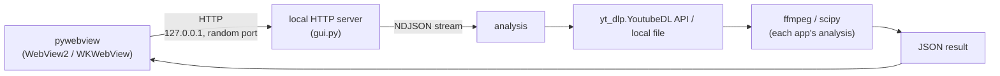
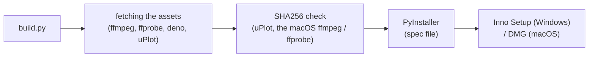

# Architecture of the analyze apps

> 日本語版は [architecture.ja.md](architecture.ja.md) を参照してください。

What analyze-loudness and analyze-spectrum (the consumers) have in common: how the desktop app is put together, the shape of its GUI endpoints and of its streamed responses, the frontend, the build and the accessibility rules. The shared code is this library. Its files are listed in [Project structure](#project-structure), its public names in [Public API](#public-api), how its modules work is in [How the modules work](#how-the-modules-work) and in `AGENTS.md` ("Design decisions"), and the security measures are in [security-model.md](security-model.md). What each app analyzes is in that app's own `docs/architecture.md`.

## Overall structure



Both apps are the same kind of desktop app:

- A native window from pywebview (WebView2 on Windows, WKWebView on macOS)
- A local HTTP server on `127.0.0.1` with a port the operating system picks (port 0)
- Progress shown from a stream of NDJSON (one JSON object per line)
- Audio downloaded with the Python API of yt-dlp (`yt_dlp.YoutubeDL`)
- ffmpeg and ffprobe started as subprocesses

The default window of both apps is 1200 x 900. Pressing Analyze moves the source in the field into the queue; one row makes a single analysis and two or more a comparison.

Both apps have: comparison (up to `MAX_TRACKS` tracks, 6), analysis of a local file (a typed path, the file dialog, a dropped file), a cache of results that lasts for the session (in a temp folder), saving a result as JSON and as an image, auto-update ([auto-update.md](auto-update.md)), and the stored theme and language.

## GUI endpoints

| Endpoint | Method | What both apps do |
|---|---|---|
| `/analyze` | POST | A URL or a local file goes through the app's analysis; the response is an NDJSON stream |
| `/save` | POST | Saves the result JSON through a native dialog |
| `/save-image` | POST | Saves a PNG sent as base64 through a native dialog |
| `/load` | POST | Picks a JSON through a native dialog and shows it again |

Both apps also have `/compare`, `/browse`, `/upload`, `/settings`, `/update/*` and `/common/*`. The Host and Content-Type checks, `/browse`, `/save-image`, `/settings`, `/update/*` and `/common/*` come from this library's `GuiHandler` ([GUI server (server)](#gui-server-server)). Each app's full list is in its `docs/architecture.md`; the "GUI endpoints" section of its `AGENTS.md` names the section.

## NDJSON protocol

A streamed response is one JSON object per line, each with a `type` (`GuiHandler._send_event()`):

```json
{"type":"progress","stage":"download","message":"..."}
{"type":"result","data":{}}
{"type":"error","error":"..."}
```

- `progress` carries a `stage` and a `message`. The stages, the other fields and the other event types of each app are in its `docs/architecture.md`; the "Response format (GUI NDJSON)" section of its `AGENTS.md` names the section
- A request that fails validation is answered with HTTP 400 and a JSON body, before the stream starts. An error after the stream has started is an `error` event inside the HTTP 200 response, because the status cannot change once the headers are sent
- The stream has no `Content-Length` and is not chunked; `Connection: close` marks its end

## Frontend

The shared scripts and style sheet, the order a page loads them in and what each function does are in [Shared frontend scripts (web)](#shared-frontend-scripts-web) and in `AGENTS.md` ("Theme and language settings").

### Charts

| Drawn with | Used for |
|---|---|
| uPlot (`frontend/vendor/` of each app) | The time-series and frequency charts (analyze-loudness's timeline, analyze-spectrum's spectrum) |
| Canvas 2D | The other charts (analyze-loudness's histogram and segment bars; analyze-spectrum's 1/3-octave bands, transfer function, low-end and mid-high charts) |

Each app holds its chart colors in one place (`getTheme()` in analyze-loudness's `frontend/theme.js`, `getThemeColors()` in analyze-spectrum's `frontend/main.js`) and redraws its charts when the theme changes.

### Theme

The theme is switched with CSS variables under `[data-theme="dark"]`. The shared variables are in `common.css` and each app's own in its `frontend/style.css`; both files define the same names for the two themes. The theme button in the toolbar goes light, dark, auto and back to light, and `auto` follows the operating system's `prefers-color-scheme`.

- `common/boot.js`, loaded in `<head>`, sets `data-theme` and `lang` on `<html>` before the first paint, so the page does not start in the other theme
- The accent color is purple (`#9C27B0`) in analyze-loudness and blue (`#1565C0`) in analyze-spectrum
- Icons are SVG made by `_createIcon()` in `common/ui.js`

### Translation (English / Japanese)

Each app's `frontend/i18n.js` hands its dictionary to `window.analyzeI18n.install(DICT)` (`common/i18n.js`), which makes `window.i18n` (`t`, `tr`, `lang`, `setLang`, `onChange`, `applyStatic`).

- The language is the stored setting when there is one, otherwise `navigator.language` (Japanese when it starts with `ja`, English for anything else)
- Static text is looked up through the `data-i18n` attributes (`data-i18n`, `data-i18n-title`, `data-i18n-placeholder`, `data-i18n-aria-label`); text made by script goes through `window.i18n.t(key)`
- The app name stays in English in the `ja` dictionary

### Toolbar

```html
<div class="toolbar"> <!-- after </main>; fixed at the top right -->
  <button id="lang-toggle" class="lang-toggle"></button>
  <button id="theme-toggle" class="theme-toggle"></button>
  <!-- common/update.js appends the settings button -->
</div>
```

### Shared components

`common.css` is the source of the sizes and colors; the functions that make the parts are in `common/ui.js`.

- Input bar buttons (`.input-bar button`): at least 44px high, padding 10px 24px
- Compare bar and result buttons (`.compare-bar button`, `.save-btn`, `.copy-btn`): at least 36px high, padding 6px 20px
- Toolbar buttons (`.lang-toggle`, `.theme-toggle`): at least 44px high, radius 22px
- A disabled button: opacity 0.5, `cursor: not-allowed`
- The Analyze button while it is Cancel (`.cancelling`): `--danger` / `--danger-fg`
- Focus ring: `outline: 2px solid var(--focus-ring); outline-offset: 2px`
- `h1` (each `style.css`): padding 0 120px, font size 1.6rem (1.2rem at 480px wide and narrower)
- The page's font: `-apple-system, "Segoe UI", "Meiryo", system-ui, sans-serif`

## Build



- Each app's `build.py` passes its names to this library's `analyze_common.build` (`AGENTS.md`, "Building a consumer (build)")
- yt-dlp is a Python dependency, which PyInstaller bundles
- The spec file takes the project root from the current directory, so the build runs from the app's root
- macOS: `_build_icns_macos()` makes `icon.icns` from `icon.iconset` for the `.app` bundle
- The licenses of the bundled software are in each app's `THIRD_PARTY_LICENSES.txt`

## Accessibility

### Reduced motion

```css
@media (prefers-reduced-motion: reduce) {
  *, *::before, *::after {
    animation-duration: 0.001ms !important;
    animation-iteration-count: 1 !important;
    transition: none !important;
    scroll-behavior: auto !important;
  }
}
```

### Tooltips

`_addTip()` in `common/ui.js` gives an element the class `.has-tip` and `tabindex="0"`, and `_showTip()` / `_hideTip()` show and hide one `.tip-popup` at a time.

- The popup has `role="tooltip"` and is tied to its element with `aria-describedby`
- It shows on `mouseenter` and `focus`, and hides on `mouseleave` and `blur`
- Escape hides it (the `keydown` handler of each `main.js`, which does nothing during an input method's composition)

### Error line

`_renderError()` in `common/ui.js` makes the icon (`aria-hidden`), the text and, when the clipboard is available, the Copy button. The status element gets `role="alert"` and `aria-live="assertive"`. Its colors are `--error` / `--error-bg` in `common.css`, with a 4px left border in `--error`.

### Landmarks

Each page has `<header><h1>...</h1></header><main>...</main>`. The toolbar comes after `</main>`, so the first Tab goes to the input field.

## Project structure

The files of this repository.

```mermaid
graph LR
    root["py-analyze-common/"]
    root --> gh_dep[".github/dependabot.yml<br>version updates every day at 00:00 JST of the SHA-pinned actions (github-actions)<br>and of the yt-dlp pin in pyproject.toml (uv)"]
    root --> gh_cc[".github/codecov.yml<br>Codecov posts its statuses once the three uploads of a commit have arrived (after_n_builds)"]
    root --> ght[".github/tests/"]
    ght --> ght_am["dependabot-auto-merge-test.sh<br>test that dependabot-auto-merge.yml runs on every PR, with only its steps limited to Dependabot PRs,<br>and of which updates and commits (their authors, how many, whether the last is the head, who committed it,<br>whether its signature is verified) its step schedules or turns off an auto-merge for, with a fake gh"]
    root --> wf[".github/workflows/"]
    wf --> wf_ci["ci.yml<br>pytest with coverage on Ubuntu and macOS on PRs and on pushes to main<br>(required checks test and test-macos of main), and tests/test_tempdirs.py on Windows;<br>the job coverage uploads the three coverage.xml reports to Codecov once all of them exist<br>(codecov/project, which Codecov reports from them, is a required check of main)"]
    wf --> wf_amt["dependabot-auto-merge-test.yml<br>runs .github/tests/dependabot-auto-merge-test.sh on PRs and pushes to main that change it or dependabot-auto-merge.yml"]
    wf --> wf_am["dependabot-auto-merge.yml<br>enables auto-merge on a Dependabot PR that is one commit at the head, written by Dependabot alone,<br>committed by GitHub (web-flow) and with a verified signature, for an update of the Python dependencies (uv)<br>or of a submodule, and for a semver patch or minor update of a GitHub Action (required check auto-merge of main)"]
    root --> r_claude["AGENTS.md"]
    root --> r_readme["README.md<br>English"]
    root --> r_readme_ja["README.ja.md<br>Japanese"]
    root --> r_lic["LICENSE"]
    root --> r_pyproj["pyproject.toml"]
    root --> docs["docs/"]
    docs --> d_up["auto-update.md<br>English: how an update runs, what is verified, the signing key"]
    docs --> d_up_ja["auto-update.ja.md<br>Japanese"]
    docs --> d_dev["development.md<br>English: testing a consumer from a worktree, per-commit test runs, probing the real app on macOS,<br>this library's CI, the patch release for an ffmpeg update"]
    docs --> d_dev_ja["development.ja.md<br>Japanese"]
    docs --> d_dec["decisions/<br>closed decisions: what was chosen, why, what was rejected, harm records;<br>each record is an English .md and a Japanese .ja.md"]
    d_dec --> d_dec_up["auto-update.md, auto-update.ja.md<br>the settings dialog's focus, the real-device checks"]
    d_dec --> d_dec_ci["ci-and-release.md, ci-and-release.ja.md<br>the workflows, Dependabot and the release path"]
    d_dec --> d_dec_doc["documentation.md, documentation.ja.md<br>the headings of the Japanese counterparts"]
    d_dec --> d_dec_gui["gui.md, gui.ja.md<br>the GUI both consumers share"]
    d_dec --> d_dec_run["runtime.md, runtime.ja.md<br>the watch on Quit, temp folders with mixed versions, a connection reset"]
    docs --> d_arch["architecture.md<br>English: what the two apps have in common (structure, GUI endpoints, NDJSON, frontend, build, accessibility),<br>and this library's file map, public API and how its modules work"]
    docs --> d_arch_ja["architecture.ja.md<br>Japanese"]
    docs --> d_sec["security-model.md<br>English: the entry points, the measures and where each is implemented, the accepted risks"]
    docs --> d_sec_ja["security-model.ja.md<br>Japanese"]
    root --> src["src/analyze_common/"]
    src --> s_init["__init__.py<br>public API (__all__), __version__"]
    src --> s_plat["platform.py<br>IS_WINDOWS / IS_MAC / IS_LINUX / IS_FROZEN, subprocess_kwargs(), find_executable()"]
    src --> s_theme["theme.py<br>is_dark_mode(): OS-native dark mode detection"]
    src --> s_ff["ffmpeg.py<br>ffmpeg_kwargs(), run_ffmpeg(), probe_info()"]
    src --> s_dl["download.py<br>download_audio(), sanitize_filename(), compute_middle(), is_url()"]
    src --> s_prog["programs.py<br>start_program(): starting a program that ends with this process (for ffmpeg and download)"]
    src --> s_json["json_util.py<br>json_safe()"]
    src --> s_upd["update.py<br>auto-update client (UpdateConfig, Updater, hold_instance_mutex)"]
    src --> s_ed["ed25519.py<br>Ed25519 signature verification (RFC 8032, pure Python)"]
    src --> s_man["update_manifest.py<br>for CI: creating and signing latest.json (python -m analyze_common.update_manifest)"]
    src --> s_ffr["ffmpeg_release.py<br>for build.py (analyze_common.build): reading, writing and fetching the bundled ffmpeg pin<br>(build_assets/ffmpeg.json), detecting new builds (python -m analyze_common.ffmpeg_release)"]
    src --> s_net["network.py<br>HTTPS fetching whose failed connection names every address it tried (for ffmpeg_release, update and build)"]
    src --> s_build["build.py<br>the consumer's build (App, main()): bundled assets, PyInstaller, Inno Setup / DMG;<br>the consumer's build.py passes its names"]
    src --> s_icons["icons.py<br>icon.ico / icon.png / icon.iconset from the consumer's build_assets/icon_draft.svg<br>(python -m analyze_common.icons)"]
    src --> s_server["server.py<br>GuiServer, the limits CACHE_MAX_ENTRIES and MAX_TRACKS, and GuiHandler: the GUI servers' shared request handling (Host / Content-Type checks, /common/*, /browse,<br>/save-image, /settings, /update/*, JSON and NDJSON answers), ClientDisconnected"]
    src --> s_win["window.py<br>process setup for one OS: set_app_user_model_id() (Windows), run_atexit_on_app_quit() (macOS)"]
    src --> s_tmp["tempdirs.py<br>InstanceLock, sweep_orphan_tempdirs(): which instances of a program run,<br>and the sweep of the temp folders a killed one left behind"]
    src --> s_set["settings.py<br>SettingsStore, settings_dir(): per-OS user settings file (JSON)"]
    src --> s_ui["ui_settings.py<br>UiSettings: theme and language settings (value validation, window background color,<br>script handed to the page), show_window_color_until_paint()"]
    src --> s_test["testing/<br>tests the consumers run on their own repository (configure() from the consumer's conftest.py)"]
    s_test --> s_test_init["__init__.py<br>configure()"]
    s_test --> s_test_rw["release_workflow.py<br>release.yaml and requirements/*.txt"]
    s_test --> s_test_tpl["third_party_licenses.py<br>the GPL texts THIRD_PARTY_LICENSES.txt names and their bundling"]
    s_test --> s_test_ejs["yt_dlp_ejs.py<br>the installed yt-dlp-ejs is the one the installed yt-dlp accepts"]
    s_test --> s_test_font["chart_font.py<br>the consumer's canvas text takes its font family from CHART_FONT_FAMILY"]
    src --> web["web/"]
    web --> w_init["__init__.py<br>WEB_DIR, COMMON_CSS, UPDATE_JS, SETTINGS_JS, I18N_JS, BOOT_JS, UI_JS"]
    web --> w_css["common.css<br>CSS shared by both GUIs (shared variables + shared components)"]
    web --> w_set["settings.js<br>shared by both GUIs: receiving and saving the stored theme and language (window.analyzeSettings)"]
    web --> w_i18n["i18n.js<br>shared by both GUIs: window.analyzeI18n.install(DICT), which sets window.i18n<br>(t / tr / lang / setLang / onChange / applyStatic)"]
    web --> w_boot["boot.js<br>shared by both GUIs: the theme and the language on the html element before the CSS paints"]
    web --> w_ui["ui.js<br>shared by both GUIs: the fonts of canvas text, the most tracks of a comparison, icons, the theme toggle's drawing,<br>the input bar's button icons, the comparison queue's rows, the result title row, tooltips,<br>reserved button widths, the drop overlay's text, the status area's error line"]
    web --> w_upd["update.js<br>shared by both GUIs: settings button, settings dialog, update check flow"]
    root --> inst["installer/"]
    inst --> inst_iss["auto_update.iss<br>Inno Setup include (waiting and relaunching for an installer started by auto-update)"]
    root --> t["tests/"]
    t --> t_conf["conftest.py<br>Ed25519 test signer, local HTTP server, executable files for find_executable(),<br>faked name resolution and connecting, a program whose writes show that it runs"]
    t --> t_dl["test_download.py"]
    t --> t_ed["test_ed25519.py"]
    t --> t_ff["test_ffmpeg.py"]
    t --> t_json["test_json_util.py"]
    t --> t_plat["test_platform.py"]
    t --> t_prog["test_programs.py<br>a program started around the atexit functions, with both ways to start one<br>and, on macOS, a real terminate:"]
    t --> t_set["test_settings.py"]
    t --> t_theme["test_theme.py"]
    t --> t_ui["test_ui_settings.py"]
    t --> t_upd["test_update.py"]
    t --> t_man["test_update_manifest.py<br>needs openssl (skipped without it)"]
    t --> t_ffr["test_ffmpeg_release.py<br>the osxexperts.net page and the BtbN listing are fixtures, zips come from a local HTTP server"]
    t --> t_net["test_network.py<br>also checks that no other module calls urllib's urlopen / urlretrieve / HTTPSHandler<br>or http.client's HTTPSConnection directly"]
    t --> t_build["test_build.py<br>the names App derives, the version and mutex read from the package,<br>the Inno Setup / create-dmg arguments, the steps each flag runs"]
    t --> t_icons["test_icons.py<br>the sizes and files icons.py renders (resvg-py and Pillow faked)"]
    t --> t_server["test_server.py<br>GuiHandler on a local server with a fake consumer state"]
    t --> t_win["test_window.py<br>the Windows process setup with faked ctypes; the macOS Quit with faked Cocoa modules<br>and, on macOS, a real terminate:"]
    t --> t_tmp["test_tempdirs.py<br>the lock of a running instance across real processes, and the sweep that reads it"]
    t --> t_web["test_web.py"]
```



## Public API

`__all__` is the single source. Only the following are public:

| Symbol | Module | Description |
|--------|--------|-------------|
| `IS_WINDOWS` | platform | `sys.platform == "win32"` |
| `IS_MAC` | platform | `sys.platform == "darwin"` |
| `IS_LINUX` | platform | `sys.platform.startswith("linux")` |
| `IS_FROZEN` | platform | PyInstaller frozen build detection |
| `subprocess_kwargs()` | platform | per-OS subprocess argument dict (Windows: hidden console, macOS frozen: DYLD_* restored) |
| `find_executable()` | platform | absolute path of a program found in the absolute entries of PATH (Windows: `name.exe`, others: an executable `name`), or `None` |
| `SettingsStore` | settings | reading and writing settings kept in one JSON file (a broken file is read as the defaults with a warning, a write replaces the file from a temporary file) |
| `settings_dir()` | settings | per-product user settings folder (Windows: `%APPDATA%`, macOS: `~/Library/Application Support`, others: `$XDG_CONFIG_HOME` or `~/.config`) |
| `UiSettings` | ui_settings | reading and writing the theme (`theme`) and language (`lang`) kept in `SettingsStore` (`values()` / `update()`), the window's background color (`background_color()`), the body of `/common/settings.js` (`script()`) |
| `show_window_color_until_paint()` | ui_settings | macOS: shows the pywebview window's `background_color` until the page paints (removes WKWebView's white background) |
| `is_dark_mode()` | theme | OS dark mode detection (Win: registry, macOS: defaults, Linux: gsettings/kreadconfig5) |
| `ffmpeg_kwargs()` | ffmpeg | subprocess_kwargs() + LC_ALL=C (for ffmpeg/ffprobe) |
| `run_ffmpeg()` | ffmpeg | `subprocess.run()` (`check`, `capture_output`, `timeout` and `Popen`'s arguments) for a program that is killed when the atexit functions run |
| `probe_info()` | ffmpeg | gets (channels, duration_sec) with ffprobe (started by the path `find_executable()` gives) |
| `download_audio()` | download | audio download with the yt-dlp Python API (ffmpeg and deno passed to yt-dlp by the paths `find_executable()` gives) |
| `sanitize_filename()` | download | file name sanitization (control characters + Windows reserved names) |
| `compute_middle()` | download | computes the start point and length of the middle extraction; `None` for both when the whole source is used |
| `is_url()` | download | HTTP(S) URL check |
| `json_safe()` | json_util | recursive NaN/Infinity → None conversion |
| `UpdateConfig` | update | per-app auto-update identity (product name, repository, current version, public key, temporary directory prefix, mutex name) |
| `Updater` | update | `status()` / `check()` / `install(version)`. `install` returns a `Handoff` |
| `Handoff` | update | how the app ends after the update is applied (`exit_mode`: `"close"` / `"immediate"` / `None`) |
| `UpdateError` | update | a failure to check, download, verify or apply |
| `hold_instance_mutex()` | update | Windows: holds the named mutex the installer waits for |
| `COMMON_CSS` | web | path of the shared CSS that both GUIs load before `style.css` |
| `UPDATE_JS` | web | path of the settings dialog and update check UI that both GUIs serve as `/common/update.js` |
| `SETTINGS_JS` | web | path of the script that receives and saves the theme and language, which `UiSettings.script()` appends after the stored values |
| `I18N_JS` | web | path of the translation script both GUIs serve as `/common/i18n.js` and load before their own `i18n.js` (the dictionary) |
| `BOOT_JS` | web | path of the script both GUIs serve as `/common/boot.js` and load in `<head>` after their `i18n.js`: the theme and the language on `<html>` before the CSS paints |
| `UI_JS` | web | path of the UI helpers both GUIs serve as `/common/ui.js` and load before their `main.js` |
| `GuiHandler` | server | the GUI server's request handler the consumer's handler extends ([GUI server](#gui-server-server)) |
| `GuiServer` | server | the GUI's HTTP server: a `ThreadingHTTPServer` whose listen backlog holds the connections a webview opens while loading a page |
| `CACHE_MAX_ENTRIES` | server | how many results each result cache of the consumer's GUI holds |
| `MAX_TRACKS` | server | how many tracks a comparison in the consumer's GUI holds (`window.MAX_TRACKS` in `web/ui.js` is a mirror, and `tests/test_web.py` checks that they match) |
| `ClientDisconnected` | server | raised by `GuiHandler._send_event()` when the client closed the connection during an NDJSON stream |
| `set_app_user_model_id()` | window | Windows: sets the process's AppUserModelID (the taskbar shows the EXE's icon) |
| `run_atexit_on_app_quit()` | window | macOS: runs the atexit functions when the app quits through `terminate:` (the Quit menu item, Cmd+Q, logging out) |
| `InstanceLock` | tempdirs | marks this process as a running instance of a program until `release()`, the end of a `with` block or the end of the process |
| `sweep_orphan_tempdirs()` | tempdirs | removes the temp folders a killed process left behind, unless another instance of the program runs |
| `__version__` | — | SemVer string |

## How the modules work

How the modules of this library work today. The sections that the consumers' instructions point at by name, and the rules to follow when changing the library, are in `AGENTS.md` ("Design decisions"). What was chosen, why and what was rejected is in `docs/decisions/`.

### subprocess_kwargs() returns a new dict every time

Restoring DYLD_* in a frozen build depends on a snapshot of the environment variables at that moment, so the result cannot be cached.

### ffmpeg ends with the app (run_ffmpeg)

The consumers run their analysis's ffmpeg through `run_ffmpeg()`, and `download_audio()` does the same for what yt-dlp starts: every program yt-dlp runs (ffmpeg, ffprobe, deno) goes through `yt_dlp.utils.Popen`, whose `__init__` is wrapped on the first call. Both start through `programs.start_program()`, which keeps each process in a `WeakSet` that one atexit function kills, so closing the app during an analysis, or quitting it with `run_atexit_on_app_quit()` in place, stops the program. It does not cover `probe_info()`, which reads a file's header with a 30-second limit.

- A start and the kill run one at a time under one lock: a program being started when the kill comes is killed as soon as its start returns, and after the kill a start raises `RuntimeError` without starting anything
- The kill is registered at the first start, and `atexit` runs the functions last in, first out, so it comes before the removal of the temp folders the consumer registered earlier. A function registered while the atexit functions run does not run, so the kill is also registered when the module loads, for a first program started in that time

### Temp folders a killed process left behind (tempdirs)

What the sweep is for and who holds the lock are in `AGENTS.md`, under the same heading.

- The lock is `flock` on macOS and Linux and `msvcrt.locking` on Windows, on a file `<prefix>instance_*.lock` in the temp folder. The operating system ends it with the process, however the process ends, and a pid is not used: a pid can come back on another process, and on Windows `os.kill(pid, 0)` sends `CTRL_C_EVENT`. The programs the process starts do not inherit the file. `tests/test_tempdirs.py` holds it in real processes and ends them with a kill, on Windows too
- While another instance runs the sweep removes nothing, so a folder of any kind stays while an instance may use it: the cache, dropped files, an analysis's work folder, an update's folders. One sweep is skipped when another instance is running at that moment, and the next process to end does it
- A lock file counts as running when another process holds its lock, when it cannot be opened, or when it is 5 seconds old or newer (its process may not have locked it yet)
- When the file system takes no locks (`ENOTSUP`, `EOPNOTSUPP`), a lock file counts as running until it is 24 hours old (`_NO_LOCKS_RUNNING_SEC`). The sweep then goes on, so an instance that has run longer than that on such a file system loses a folder that has not changed for an hour
- Any other error of a lock (`ENOLCK`, for one) counts as running, however old the file is
- `InstanceLock()` writes one line to stderr when it cannot lock its file, and goes on
- The sweep removes a lock file it can lock, which is what a killed process leaves. `release()` removes the process's own
- Without another instance, the sweep removes only `prefix*` folders that have not changed for an hour (`ORPHAN_MIN_AGE_SEC`), so the folders of a process that starts during the sweep stay

### Dark mode detection priority (Linux)

1. GNOME `color-scheme` (GNOME 42+)
2. GNOME `gtk-theme` (GNOME <42 fallback)
3. KDE `kreadconfig5` (True if the value contains "dark")
4. All of the above fail → `False`

subprocess runs with `LC_ALL=C`, which avoids substring match failures caused by locale-dependent translations ("Dunkel" etc.).

### sanitize_filename() adopts the spectrum version (the strict version)

Removes the control characters 0x00-0x1F explicitly. The loudness version did not include `\x00-\x1f`, but yt-dlp metadata can contain control characters, and this prevents `open()` from failing with `ValueError('embedded null byte')`.

### compute_middle()

The message is plain text without a prefix (`[info]` etc.). Each consumer controls the display format.

When the source is no longer than the minutes asked for, the start and the length are `None`. The consumer passes them to ffmpeg, which then has no `-ss` and no `-t` and reads to the end of the source. The total the function receives comes from ffprobe, which estimates it from the bit rate for a VBR MP3 without a Xing header and can come out shorter than the source.

### GUI server (server)

The consumer's `AnalyzeHandler` extends `GuiHandler`: it sets `frontend_dir`, `save_image_name`, `_AUDIO_TYPES` and, when they differ from 10 MB / 50 MB, `_MAX_BODY` / `_MAX_IMAGE_BODY`; returns its state from `updater()`, `ui_settings()`, `window()`, `dialog_lock()` and `exit_for_update(exit_mode)`; and its `do_POST` routes `_shared_handlers()` (`/save-image`, `/browse`, `/settings`, `/update/*`) together with its own endpoints. The state is read through these methods on every request, so a consumer that keeps it in module globals (and tests that replace them) needs nothing more.

- `do_GET` serves `/common/settings.js` (`UiSettings.script()`, `Cache-Control: no-store`), the files of `web/` at `/common/*`, and `frontend_dir`. Every request is refused with 403 unless its Host is `127.0.0.1` or `localhost`, and `_check_content_type()` answers 415 unless a POST is `application/json` (`application/octet-stream` for `/upload`)
- `_read_json_body()` returns `None` for a body that is not JSON or is larger than the limit, and `{}` for an empty one
- `_send_event()` writes one NDJSON line with NaN / Infinity as `null`; when the client has gone, it prints the traceback and raises `ClientDisconnected`
- `finish()` ends the response, then reads what the client still sends until it closes or `_LINGER_SEC` passes. A handler can answer before the request body it does not read has arrived (`/browse`, `/update/status`, `/update/check`, the consumers' `/load`, and any refused request). A body that reaches a closed socket resets the connection, which can take the response from a client that has not read it yet
- `window.py`: `run_atexit_on_app_quit()` does nothing outside macOS; the consumer calls it from `main()`. pywebview's Quit menu item has the action `terminate:`, and AppKit ends the process with C's `exit()`, so the interpreter does not finish and neither the atexit functions nor the finalizers of a `TemporaryDirectory` run; closing the last window returns from `webview.start()` and they do run. The function observes `NSApplicationWillTerminateNotification` and calls `atexit._run_exitfuncs()`, which runs each function once. Before that it arms `faulthandler.dump_traceback_later(_QUIT_LIMIT_SEC, file=2, exit=True)`, whose thread needs no GIL: a process still running at the limit, in an atexit function or in C's `exit()`, writes every thread's stack to file descriptor 2 and ends with exit code 1. `tests/test_window.py` runs a real `terminate:` on macOS, with and without it, and stalled in each of those places
- `window.py`: `set_app_user_model_id()` does nothing outside Windows; the consumer calls it from `main()`. WebView2's `AllowExternalDrop` (whether files can be dropped into it) is left at its default, true, so the page's drop handler receives dropped files; pywebview (6.2.1) itself turns off WebView2's swipe navigation

### Shared frontend scripts (web)

The consumer's `index.html` loads, in `<head>`: `common/settings.js`, `common/i18n.js`, its own `i18n.js` (which calls `window.analyzeI18n.install(DICT)`), `common/boot.js`, then `common/common.css` before its `style.css`; and at the end of `<body>`: `common/ui.js` and `common/update.js` before its `main.js`. `ui.js` is a classic script whose functions (`_createIcon()`, `_applyThemeMode()`, `_applyButtonIcons()`, `_createTrackRow()`, `_replaceTrackRows()`, `_redrawKeepingFocus()`, `_afterResize()`, `_createTitleRow()`, `_addTip()`, `_reserveButtonWidth()`, `_classButtonWidth()`, `_renderError()` and the others) are globals that `main.js` calls; it reads `window.i18n` and the i18n keys `theme.title.*`, `theme.aria_state.*`, `track.tag_*`, `track.move_up`, `track.move_down`, `track.remove`, `drop.overlay`, `err.prefix` and `btn.copy*` of the consumer's dictionary.

`common.css` gives every button and field (`button`, `input`, `select`, `textarea`) the page's font with `font-family: inherit`, instead of the engine's default control font.

A canvas does not take the page's font, so `ui.js` holds `CHART_FONT_FAMILY`, the families of the page's font in `common.css` in the same order (`tests/test_web.py` checks that they match). The consumers' charts and PNG export draw their text in it (`ctx.font = "10px " + CHART_FONT_FAMILY`), and their uPlot axes spread `CHART_AXIS_FONTS` into their options, which keeps uPlot's sizes. uPlot's legend is HTML text whose style sheet loads after `common.css` and names a font of its own, so `common.css` gives it the page's font with a selector of higher specificity (`body .uplot`). The consumer's chart scripts load before `ui.js` and read them when they draw. `analyze_common.testing.chart_font` fails when a consumer's script names a font of its own.

The input bar (`#browse-btn`, `#submit-btn`, `#add-btn`, `#load-btn`), the comparison queue (`#track-list`, filled with `_createTrackRow()`) and the compare bar (`#clear-btn`) look the same in both GUIs:

- `common.css` gives every button of the input bar and the compare bar its shape and a face by role: Browse and Clear All neutral (`--neutral-*`), Add Track green (`--add-*`), both defined here; Analyze and Load JSON from the consumer's `style.css` (`--primary-bg` / `--primary-bg-hover` / `--primary-fg`, `--load-bg` / `--load-bg-hover` / `--load-fg`), so each app keeps its accent. In the dark theme hover makes a face lighter. At 900 CSS px wide and narrower the bar wraps: the field takes a row of its own and the buttons share the row below it. The queue rows read `--track-bg`, `--track-tag-bg`, `--track-tag-fg` and `--track-remove` from `style.css`
- `_applyButtonIcons()` puts a folder icon on Browse and a document icon on Load JSON; their labels are `<span data-i18n>` inside the button, so the translation pass keeps the icon. `main.js` calls it before reserving the button widths. The icons appear when `main.js` runs, together with the theme toggle's icon. Chromium (WebView2) can paint the page before that, so on Windows the first frame can show these buttons without their icons
- `_createTrackRow(track, on)` makes one queue row: the track's color, its number, a tag of its kind (URL / FILE / JSON), its source, and the move up / move down / remove buttons (`.track-btn` with `data-action` up / down / remove; the slot of a move the row cannot make is a hidden placeholder). The consumer decides the kind of each source, puts the rows in with `_replaceTrackRows(list, rows, move)` (`move` is `{from, to}` after it swapped the tracks of those rows) and redraws them on a theme or language change. `_replaceTrackRows()` hands a focused row button's focus to the button with the same action in the row at the same position (the last row when the queue got shorter), or to that row's remove button when that action has no button there now. After a move the focus follows its track to the other row, and the row itself takes it when the same action has no button there (a move to the top or the bottom), so a further key press does nothing

The status area (`#status`) has the same rule in both GUIs: one line's height reserved, so the results start at the same place.

The result title row, the save buttons and the Copy button of an error line also look the same in both GUIs:

- `common.css` styles the date and source line under the row (`.meta-info`); a source link in it keeps the line's color
- `_createTitleRow(title)` makes the row (`.title-row`) with the title as an `h2.result-title`; the consumer appends its save buttons (`.save-btn`) after it. The title sits on the left and wraps when it is long, and the buttons sit on the right. The title color is `--result-title-fg` from the consumer's `style.css`
- `common.css` gives `.save-btn` the shape of the compare bar's buttons and the primary face (`--primary-*`), and `.copy-btn` (made by `_renderError()`) the same shape, outlined (`--copy-bg`, `--copy-bg-hover`, `--copy-border`, `--copy-fg`, defined here with the error line's `--error-bg`)

`_redrawKeepingFocus(container, redraw)` runs a redraw that rebuilds what is inside `container` (the consumers' `#results`, which has `tabindex="-1"`): when the focus was inside `container` and the redraw took it out, `container` takes it; focus anywhere else stays where it is. The page goes back to the scroll position it had in a microtask queued after the redraw: taking out the old content makes the page shorter than that position while the redraw runs, and a uPlot chart the redraw makes has its final height only in a microtask of its own, queued before that one.

`_afterResize(then)` runs `then()` 200 ms after the last of a run of calls; the consumers call it from their `resize` listener and redraw in `then()`. When an input or a textarea has the focus at the first call of the run, a redraw through `_redrawKeepingFocus()` in `then()` goes back to the scroll position the page had at that call: in WKWebView (macOS), a change of the window's width while the URL field has the focus moves the page to the top before `then()` runs. Until then the page also goes back to that position on each `scroll` event, so a scroll during the run, the user's included, does not stay. The position is dropped when `then()` returns, whether it redrew or not.

### Fetching over HTTPS (network)

`ffmpeg_release._read()`, `update._open()` and the downloads of `build.py` make their HTTPS connections through `network` (`urlopen()`, or `HTTPSHandler` in an opener of their own).

- `connect()` tries the host's addresses in the order `getaddrinfo` returns them, each with the fetch's timeout and with the address as `getaddrinfo` gives it (an IPv6 scope id included), as `socket.create_connection` does. When every address fails, it raises `ConnectError`, an `OSError` that names each address with its own error (`could not connect to HOST port PORT (ADDRESS: ERROR; ...)`); `socket.create_connection` reports the last address's error only. urllib hands it on as the `reason` of a `URLError`
- `HTTPSHandler` is `urllib.request.HTTPSHandler` whose connections connect with `connect()`; TLS still checks the certificate against the host name. Plain `http://` goes through urllib's own handler
- `tests/test_network.py` fails when another module of the package calls `urllib.request.urlopen` / `urlretrieve` / `HTTPSHandler` or `http.client.HTTPSConnection` directly

### Tests the consumers share (testing)

`analyze_common/testing/` holds tests that check a consumer's own repository and environment, not this package: the consumer's `tests/conftest.py` calls `testing.configure(root, package)`, and a one-line test file of the consumer (`from analyze_common.testing.release_workflow import *`) has pytest collect them as the consumer's tests. A module reads `testing.app()` when it is imported, so `configure()` has to run in `conftest.py`. The modules' names do not start with `test_`, so this repository's own pytest does not collect them (they need a consumer's repository, and `yt_dlp_ejs` needs yt-dlp-ejs).

### Bundled ffmpeg pin (ffmpeg_release)

The pin file, how each OS bundles ffmpeg, how the pin is updated and how a release build verifies it are in `AGENTS.md`, under the same heading. The parts of `ffmpeg_release.py`:

- The osxexperts.net page (`parse_osxexperts()`): for each "Download ffmpeg X.Y (Apple Silicon)" or "Download ffmpeg X.Y.Z (Apple Silicon)" link, reads the "SHA256 checksum of ... file : <hex>" found before the next download link. Fails unless there is exactly one Apple Silicon build each of ffmpeg / ffprobe, with the same full version (`MAJOR.MINOR` or `MAJOR.MINOR.PATCH`), and the link is a zip under `https://www.osxexperts.net/`. The pin's `series` is the `MAJOR.MINOR` part for BtbN; each macOS URL and digest is kept as the page lists it. ffplay and the Intel builds are not read
- The SHA256 is the value of the binary inside, not of the zip (the same value the page lists)
- BtbN (`btbn_asset()`): `ffmpeg-n{series}-latest-win64-gpl-{series}.zip` in `releases/tags/latest`. Fails when it is absent (lgpl builds are not used)
- `detect` (CLI): only when the pin and the page differ, it checks the BtbN series, downloads both files, checks them against the page's SHA256, and writes the new pin to `--candidate`. Whether a patch release is needed (`bump`) is `true` when `__version__` equals the latest `vX.Y.Z` tag and either the pin changes this time or the current pin differs from the pin that tag released. The pin a tag released (`released_pin()`) is the pin in the pin file at the tag, or, when the tag has none, the pin of the first commit after the tag that added the file. When neither exists, the latter comparison is not made
- `release_sha` of `detect`: when `__version__` is `MAJOR.MINOR.PATCH` and there is no `v{version}` tag, the commit in HEAD's first-parent history that introduced that version (`pending_release()`). The consumer's `ffmpeg-watch.yml` uses it to resume from the state where the version bump was merged but no tag was created, by passing that commit to `tag-release.yml`. Empty otherwise
- Exit status of `detect`: 3 when no address of a host it fetches from accepted the connection (`network.ConnectError`, on its own or as the `reason` of a `URLError`), 1 on any other failure (a timeout or an error after the connection included), 0 otherwise. The consumer's `ffmpeg-watch.yml` runs detect again on another runner on 3 ([Patch release for an ffmpeg update](../AGENTS.md#patch-release-for-an-ffmpeg-update))
- Fetching (`_read()`: the page, the BtbN listing and the downloads) goes through `network.urlopen()` ([Fetching over HTTPS](#fetching-over-https-network))
