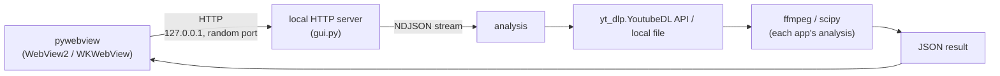
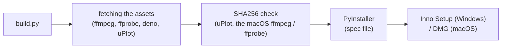

# Architecture of the analyze apps

> 日本語版は [architecture.ja.md](architecture.ja.md) を参照してください。

What analyze-loudness and analyze-spectrum (the consumers) have in common: how the desktop app is put together, the shape of its GUI endpoints and of its streamed responses, the frontend, the build and the accessibility rules. The shared code is this library. Its modules are listed in `AGENTS.md` ("Project structure"), how each of them works is in `AGENTS.md` ("Design decisions"), and the security measures are in [security-model.md](security-model.md). What each app analyzes is in that app's own `docs/architecture.md`.

## Overall structure



Both apps are the same kind of desktop app:

- A native window from pywebview (WebView2 on Windows, WKWebView on macOS)
- A local HTTP server on `127.0.0.1` with a port the operating system picks (port 0)
- Progress shown from a stream of NDJSON (one JSON object per line)
- Audio downloaded with the Python API of yt-dlp (`yt_dlp.YoutubeDL`)
- ffmpeg and ffprobe started as subprocesses

The default window of both apps is 1200 x 900. Pressing Analyze moves the source in the field into the queue; one row makes a single analysis and two or more a comparison.

Both apps have: comparison (up to `MAX_TRACKS` tracks, 6), analysis of a local file (a typed path, the file dialog, a dropped file), a cache of results that lasts for the session (in a temp folder), saving a result as JSON and as an image, auto-update ([auto-update.md](auto-update.md)), and the stored theme and language.

## GUI endpoints

| Endpoint | Method | What both apps do |
|---|---|---|
| `/analyze` | POST | A URL or a local file goes through the app's analysis; the response is an NDJSON stream |
| `/save` | POST | Saves the result JSON through a native dialog |
| `/save-image` | POST | Saves a PNG sent as base64 through a native dialog |
| `/load` | POST | Picks a JSON through a native dialog and shows it again |

Both apps also have `/compare`, `/browse`, `/upload`, `/settings`, `/update/*` and `/common/*`. The Host and Content-Type checks, `/browse`, `/save-image`, `/settings`, `/update/*` and `/common/*` come from this library's `GuiHandler` (`AGENTS.md`, "GUI server (server)"). Each app's full list is in the "GUI endpoints" section of its `AGENTS.md`.

## NDJSON protocol

A streamed response is one JSON object per line, each with a `type` (`GuiHandler._send_event()`):

```json
{"type":"progress","stage":"download","message":"..."}
{"type":"result","data":{}}
{"type":"error","error":"..."}
```

- `progress` carries a `stage` and a `message`. The stages, the other fields and the other event types of each app are in the "Response format (GUI NDJSON)" section of its `AGENTS.md`
- A request that fails validation is answered with HTTP 400 and a JSON body, before the stream starts. An error after the stream has started is an `error` event inside the HTTP 200 response, because the status cannot change once the headers are sent
- The stream has no `Content-Length` and is not chunked; `Connection: close` marks its end

## Frontend

The shared scripts and style sheet, the order a page loads them in and what each function does are in `AGENTS.md` ("Shared frontend scripts (web)", "Theme and language settings").

### Charts

| Drawn with | Used for |
|---|---|
| uPlot (`frontend/vendor/` of each app) | The time-series and frequency charts (analyze-loudness's timeline, analyze-spectrum's spectrum) |
| Canvas 2D | The other charts (analyze-loudness's histogram and segment bars; analyze-spectrum's 1/3-octave bands, transfer function, low-end and mid-high charts) |

Each app holds its chart colors in one place (`getTheme()` in analyze-loudness's `frontend/theme.js`, `getThemeColors()` in analyze-spectrum's `frontend/main.js`) and redraws its charts when the theme changes.

### Theme

The theme is switched with CSS variables under `[data-theme="dark"]`. The shared variables are in `common.css` and each app's own in its `frontend/style.css`; both files define the same names for the two themes. The theme button in the toolbar goes light, dark, auto and back to light, and `auto` follows the operating system's `prefers-color-scheme`.

- `common/boot.js`, loaded in `<head>`, sets `data-theme` and `lang` on `<html>` before the first paint, so the page does not start in the other theme
- The accent color is purple (`#9C27B0`) in analyze-loudness and blue (`#1565C0`) in analyze-spectrum
- Icons are SVG made by `_createIcon()` in `common/ui.js`

### Translation (English / Japanese)

Each app's `frontend/i18n.js` hands its dictionary to `window.analyzeI18n.install(DICT)` (`common/i18n.js`), which makes `window.i18n` (`t`, `tr`, `lang`, `setLang`, `onChange`, `applyStatic`).

- The language is the stored setting when there is one, otherwise `navigator.language` (Japanese when it starts with `ja`, English for anything else)
- Static text is looked up through the `data-i18n` attributes (`data-i18n`, `data-i18n-title`, `data-i18n-placeholder`, `data-i18n-aria-label`); text made by script goes through `window.i18n.t(key)`
- The app name stays in English in the `ja` dictionary

### Toolbar

```html
<div class="toolbar"> <!-- after </main>; fixed at the top right -->
  <button id="lang-toggle" class="lang-toggle"></button>
  <button id="theme-toggle" class="theme-toggle"></button>
  <!-- common/update.js appends the settings button -->
</div>
```

### Shared components

`common.css` is the source of the sizes and colors; the functions that make the parts are in `common/ui.js`.

- Input bar buttons (`.input-bar button`): at least 44px high, padding 10px 24px
- Compare bar and result buttons (`.compare-bar button`, `.save-btn`, `.copy-btn`): at least 36px high, padding 6px 20px
- Toolbar buttons (`.lang-toggle`, `.theme-toggle`): at least 44px high, radius 22px
- A disabled button: opacity 0.5, `cursor: not-allowed`
- The Analyze button while it is Cancel (`.cancelling`): `--danger` / `--danger-fg`
- Focus ring: `outline: 2px solid var(--focus-ring); outline-offset: 2px`
- `h1` (each `style.css`): padding 0 120px, font size 1.6rem (1.2rem at 480px wide and narrower)
- The page's font: `-apple-system, "Segoe UI", "Meiryo", system-ui, sans-serif`

## Build



- Each app's `build.py` passes its names to this library's `analyze_common.build` (`AGENTS.md`, "Building a consumer (build)")
- yt-dlp is a Python dependency, which PyInstaller bundles
- The spec file takes the project root from the current directory, so the build runs from the app's root
- macOS: `_build_icns_macos()` makes `icon.icns` from `icon.iconset` for the `.app` bundle
- The licenses of the bundled software are in each app's `THIRD_PARTY_LICENSES.txt`

## Accessibility

### Reduced motion

```css
@media (prefers-reduced-motion: reduce) {
  *, *::before, *::after {
    animation-duration: 0.001ms !important;
    animation-iteration-count: 1 !important;
    transition: none !important;
    scroll-behavior: auto !important;
  }
}
```

### Tooltips

`_addTip()` in `common/ui.js` gives an element the class `.has-tip` and `tabindex="0"`, and `_showTip()` / `_hideTip()` show and hide one `.tip-popup` at a time.

- The popup has `role="tooltip"` and is tied to its element with `aria-describedby`
- It shows on `mouseenter` and `focus`, and hides on `mouseleave` and `blur`
- Escape hides it (the `keydown` handler of each `main.js`, which does nothing during an input method's composition)

### Error line

`_renderError()` in `common/ui.js` makes the icon (`aria-hidden`), the text and, when the clipboard is available, the Copy button. The status element gets `role="alert"` and `aria-live="assertive"`. Its colors are `--error` / `--error-bg` in `common.css`, with a 4px left border in `--error`.

### Landmarks

Each page has `<header><h1>...</h1></header><main>...</main>`. The toolbar comes after `</main>`, so the first Tab goes to the input field.
