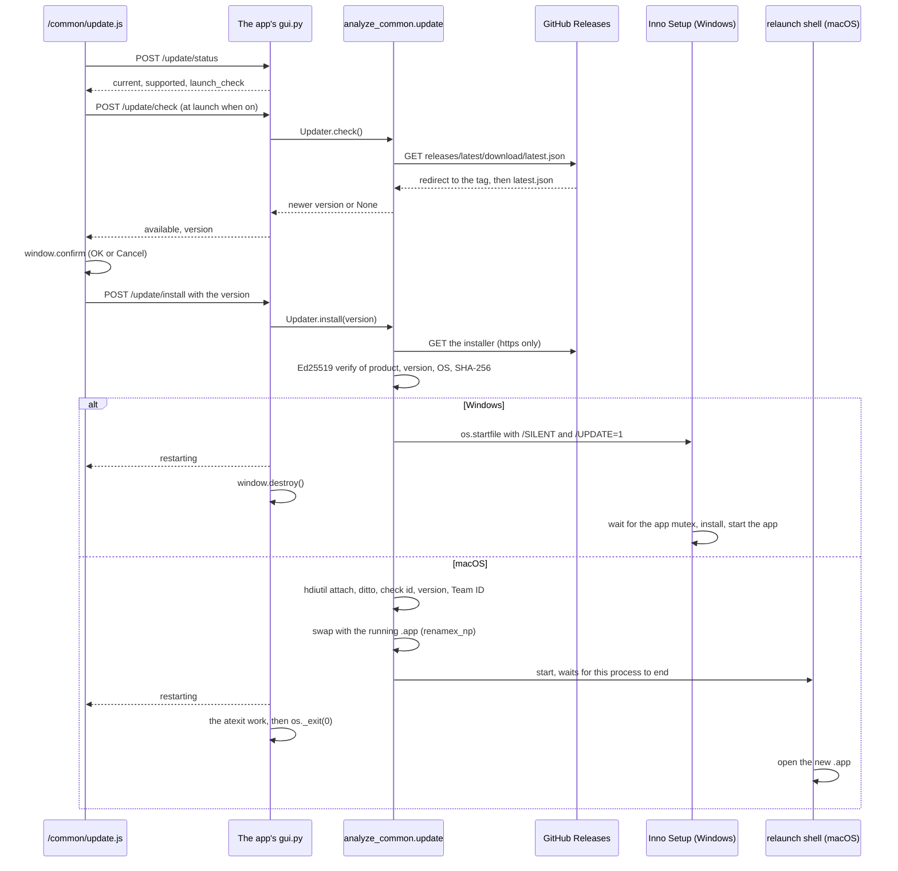

# 自動更新

> English version: [auto-update.md](auto-update.md)

analyze-loudness と analyze-spectrum が使う自動更新の説明。マニフェストの形式、署名の対象、OS ごとの適用手順は `src/analyze_common/update.py` の docstring を正とする。

## 概要

インストールしたアプリ (frozen の Windows x64 / macOS arm64 のビルド) は、起動時 (「起動時に確認」が ON のとき) と設定ダイアログの「今すぐ確認」で、GitHub の最新の Release を確かめる。新しい版があれば確認ダイアログ (`window.confirm`、OK / キャンセル) を出し、OK のときだけ Windows のインストーラーか macOS のディスクイメージ (DMG) を取得し、検証して適用し、アプリを再起動する。

| 役割 | ファイル |
|------|------|
| 確認・取得・検証・適用 | `src/analyze_common/update.py` |
| 設定ボタン・設定ダイアログ・確認の流れ | `src/analyze_common/web/update.js` (`/common/update.js` で配信) |
| `/update/*` のエンドポイント | `src/analyze_common/server.py` の `GuiHandler` |
| 更新のときの Windows のインストーラーの動き | `installer/auto_update.iss` |
| 継続的インテグレーション (CI) での `latest.json` の署名 | `src/analyze_common/update_manifest.py` |
| アプリ固有の値と終わり方 | 各アプリの `src/<package>/update.py` の `UPDATE_CONFIG` と、`src/<package>/gui.py` の終了処理 |

frozen でない起動は更新できない。設定ダイアログはボタンを無効にし、"Available in the installed app only." と表示する。



## 利用者に見えること

インストール版のアプリ (Windows のインストーラー版、macOS のディスクイメージ (DMG) 版) は、起動時に自分のリポジトリの GitHub の Releases で新しい版があるかを確認する (分析で取得する音声を除くと、アプリが自分から行う通信はこれだけ)。新しい版があれば「バージョン {version} が利用可能です。今すぐ更新しますか?」と確認し (`{version}` のところに新しい版が入る)、OK を押したときだけ更新を取得し、改ざんされていないことをアプリに組み込んだ公開鍵と署名で確かめてからインストールし、アプリを再起動する。キャンセルすると何もダウンロードしない。再起動すると、保存していない分析結果は消える。

- 右上の歯車ボタンの設定で、起動時の確認を止められる (「起動時に確認」)。「今すぐ確認」で手動でも確認できる
- 起動時の確認は、最新のときと確認に失敗したときは何も表示しない。「今すぐ確認」はそれらの結果をダイアログ内に出す。両方が重なると 1 回の確認にまとめる。
- 分析中は確認ダイアログを出さずに断り、「今すぐ確認」はダイアログ内にそう出す。分析が終わってから「今すぐ確認」を押す。
- ダウンロード中は、入力欄、分析、結果の保存、設定ダイアログを止める。
- 確認以外の失敗はステータス欄にエラーとして出す。操作は戻り、アプリは動き続ける。
- Windows: インストーラーが動くときに、ユーザーアカウント制御 (UAC) の確認が出る。そのときアプリはもう閉じているので、「いいえ」を選ぶと更新はされず、アプリは閉じたままになる。もう一度起動すると、更新の確認がまた出る (起動時の確認を止めていないとき)
- macOS: アプリを「アプリケーション」フォルダに入れて使う。フォルダに書き込む権限が無いときは管理者のパスワードを求める。同じアプリを 2 つ起動しているときは、片方を終了してから更新する
- 更新の確認とダウンロードの接続先は github.com のリリースと、GitHub がリリースのファイルの取得をリダイレクトする配信先 (release-assets.githubusercontent.com)。リクエストの User-Agent はアプリ名と版 (例: `analyze-loudness/<version>`)

## 「起動時に確認」の設定

- `/update/settings` がアプリの設定ファイルの `update_check_at_launch` に保存し、`/update/status` が返す。`Updater` が `SettingsStore` (`src/analyze_common/settings.py`、既定は `settings_dir(product)/settings.json`) で読み書きする。既定は ON。
- ファイルは、macOS は `~/Library/Application Support/<product>/settings.json`、Windows は `%APPDATA%\<product>\settings.json`。
- 保存の要求を送っている間はトグルを無効にするので要求は重ならず、保存の後はサーバーが返した値で描き直す。保存に失敗すると保存前の値に戻し、ダイアログ内にそう出す。
- webview の localStorage には置かない。次の起動に残らないため: pywebview 6.2.1 の `webview.start()` は既定で `private_mode=True` で、起動ごとに website data を消す。private mode を切っても、ローカルサーバーのポートは起動ごとに変わり origin が変わる。2026-10-20 に pywebview を 2 回起動して確認した: private mode 既定では同じポートでも前回の値は読めず、private mode を切ると同じポートでは読め、別のポートでは読めない。

## 検証するもの

- **マニフェスト**: 各 Release の `latest.json` は `{"version", "platforms": {"windows-x86_64" | "darwin-aarch64": {"url", "signature"}}}` で、`https://github.com/{repo}/releases/latest/download/latest.json` から取得する。
- **署名**: Ed25519。署名の対象は `analyze-update-v1\n{product}\n{version}\n{platform}\n{sha256}\n` (`statement()`)。版、OS、製品名が入るので、古い正規のインストーラーへの版番号の付け替えと、別の OS や別のアプリのファイルの流用は検証で落ちる。
- **検証する場所**: 純 Python (`src/analyze_common/ed25519.py`、RFC 8032)。各アプリの spec が `cryptography` を除いているため。
- **署名する場所**: CI で `openssl pkeyutl -rawin` が作る。`src/analyze_common/update_manifest.py sign` は、作った署名をアプリの公開鍵で検証し、一致しなければ終了コード 1 で終わる。
- **取得する先**: `https://github.com/{repo}/releases/download/` の下の URL だけを受け付け、https のままのリダイレクトだけをたどる。認証局は certifi で、関数の中で import する。CI でのマニフェストの作成には要らないため。

## OS ごとの適用

### Windows

- 検証したインストーラーを `os.startfile(path, "open", INSTALLER_ARGS)` で起動する。引数は `/SILENT /SUPPRESSMSGBOXES /NORESTART /CLOSEAPPLICATIONS /UPDATE=1`。アプリはウィンドウを閉じて普通に終わる (`Handoff("close")`)。
- 各アプリの `installer.iss` が読み込む `installer/auto_update.iss` は、`/UPDATE=1` のときだけアプリの mutex が消えるのを待ち、インストールし、元のユーザーの権限でアプリを起動する。30 秒たっても mutex があると Inno Setup の「実行中」のメッセージを出す。OK でまた待ち、キャンセルでインストールせずに終わる。
- mutex の名前は `UPDATE_CONFIG.mutex_name` だけが持つ。アプリの `main()` が `hold_instance_mutex()` で保持し、`build.py` が `/DMyAppMutex=` で Inno Setup に渡す (未定義なら各 `installer.iss` の `#error` で止まる)。
- ユーザーアカウント制御 (UAC) の確認はインストーラーが出す。Inno Setup の loader は `asInvoker` で起動し、必要になってから昇格を求めるので、UAC はアプリが閉じた後に出る。拒否するとインストールされず、アプリは閉じたままになる。起動し直すと旧版が起動し、起動時の確認が ON なら同じ更新をもう一度勧める。

### macOS

- DMG を `hdiutil attach` で開き、`.app` を同じボリュームの一時ディレクトリへ `ditto` でコピーし、識別子と版を確かめる。今の版が Team ID で署名されているときは、同じ Team ID であることと `codesign --verify --deep --strict` も確かめる。
- 動いている `.app` と `renamex_np(RENAME_SWAP)` で入れ替える。使えないときは 2 回の rename で、権限が無いときは osascript で管理者のパスワードを求める。
- 同じ実行ファイルの別プロセスが動いている間は入れ替えない (入れ替えた bundle の上で動き続けることになるため)。DMG の中や App Translocation から起動したときも入れ替えない。
- 入れ替えの後、アプリはすぐに終わる (`Handoff("immediate")`): 応答を返し、atexit の後始末を自分で行い、`os._exit(0)` を呼ぶ。PyInstaller は遅延 import のたびにアーカイブをパスで開き直すので、入れ替えの後に import が走ると新しい版のファイルを読むため。
- 再起動は、このプロセスの終わりを待ってから `open` を実行する `/bin/sh` が行う。

### 起動するプロセスの環境

`open` で起動したアプリには呼び出し側の環境変数が渡る (2026-10-20 に、テスト用の変数と `_PYI_PARENT_PROCESS_LEVEL=1` が再起動後のプロセスに渡ることを `ps -wwE` で確認)。PyInstaller 6.9 以降の bootloader は、`_PYI_ARCHIVE_FILE` が自分と同じなら親の worker として振る舞うので、再起動用のシェルとインストーラーに `PYINSTALLER_RESET_ENVIRONMENT=1` を渡して独立したプロセスとして起動させる。

## 署名の鍵 (初回のみ)

更新は Ed25519 で署名する。macOS のコード署名とは別の鍵を使う。秘密鍵はリポジトリに入れず、PEM の中身をリポジトリの secret `UPDATE_SIGNING_KEY` に登録する。公開鍵 (生の 32 バイトの base64) は、アプリの `src/<package>/update.py` の `PUBLIC_KEY` に書く。鍵の作成には OpenSSL 3 以降が要る: macOS に付属の LibreSSL 3.3 は Ed25519 の鍵を作れないので、Homebrew の `openssl@3` を使う。

```bash
openssl genpkey -algorithm ed25519 -out ~/.analyze-update/<app>-update.pem
PYTHONPATH=vendor/py-analyze-common/src .venv/bin/python -m analyze_common.update_manifest public-key ~/.analyze-update/<app>-update.pem
gh secret set UPDATE_SIGNING_KEY --repo semnil/<app> < ~/.analyze-update/<app>-update.pem
```

`.github/workflows/release.yaml` の `sign-manifest` ジョブが `python -m analyze_common.update_manifest sign` で `latest.json` を作り、`create-release` ジョブがインストーラーと一緒に Release に載せる。

- `UPDATE_SIGNING_KEY` を参照するのは `sign-manifest` だけ。読み取り専用のトークン、認証情報を残さない checkout、pip のキャッシュなしで走り、`requirements/sign-manifest.txt` の `yt-dlp` の wheel だけを入れる (`--require-hashes --no-deps --only-binary :all:`。`analyze_common` が `yt_dlp` を import するため)。
- `contents: write` を持つのは `create-release` だけで、Python を走らせない。`analyze_common.testing.release_workflow` のテストが両方を確かめる。
- `sign-manifest` は、secret が無いとき、署名を `PUBLIC_KEY` で検証できないとき (secret と公開鍵が一致しないとき)、タグが `v` + `__version__` でないときに失敗し、Release は作られない。

鍵を作り直すと、`PUBLIC_KEY` を書き換える前の版のアプリは新しい鍵で署名した更新を受け付けない。その版の利用者は、新しいインストーラーを手で入れ直す。

## macOS の実機確認

2026-10-20 に、ローカルで署名なしでビルドした analyze-loudness 1.4.1 / 1.4.2 をローカルで配信して確かめた:

- 1.4.1 から更新すると、`/update/install` の応答の 3.8 秒後に旧プロセスが終わり、4.1 秒後に同じパスから 1.4.2 が起動した。一時ディレクトリと `.app` の隣のファイルは残らなかった。
- 1 バイトを反転した DMG は拒否され、旧版が動き続けた。
- 2 つ起動しているときは入れ替えなかった。
- frozen のビルドから github.com への確認は Transport Layer Security とリダイレクトを通り、`v1.4.1` に `latest.json` が無いことによる 404 になった。
