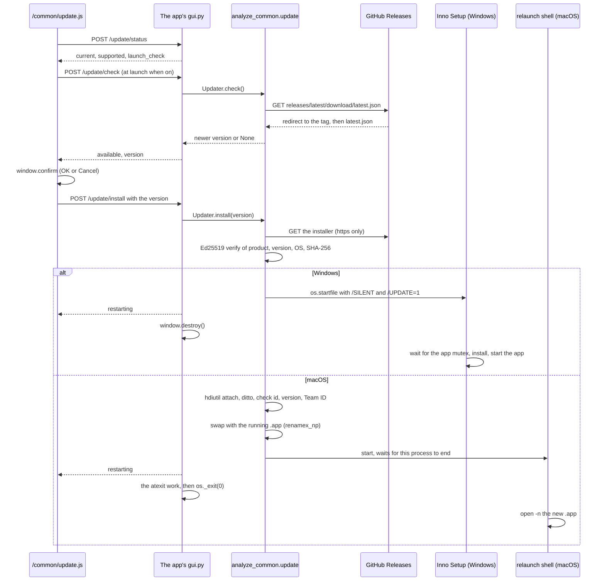

# Auto-update

> 日本語版は [auto-update.ja.md](auto-update.ja.md) を参照してください。

The auto-update both analyze-loudness and analyze-spectrum use. The docstring of `src/analyze_common/update.py` is authoritative for the manifest format, what is signed, and the apply procedure on each OS.

## Overview

The installed app (the frozen Windows x64 / macOS arm64 build) checks GitHub's latest Release at launch, when "Check at launch" is on, and from "Check now" in the settings dialog. When there is a newer version it shows a confirmation dialog (`window.confirm`, OK / Cancel), and only on OK does it fetch the Windows installer or the macOS disk image (DMG), verify it, apply it and restart the app.

| Part | File |
|------|------|
| Checking, fetching, verifying, applying | `src/analyze_common/update.py` |
| Settings button, settings dialog, confirmation flow | `src/analyze_common/web/update.js`, served as `/common/update.js` |
| The `/update/*` endpoints | `GuiHandler` in `src/analyze_common/server.py` |
| The Windows installer's behavior during an update | `installer/auto_update.iss` |
| Signing `latest.json` in continuous integration (CI) | `src/analyze_common/update_manifest.py` |
| The app's own values and how it ends | Each app's `UPDATE_CONFIG` in `src/<package>/update.py`, and its exit function in `src/<package>/gui.py` |

A start that is not frozen cannot update: the settings dialog disables the button and shows "Available in the installed app only."



## What the user sees

The installed app (the installer version on Windows, the disk image (DMG) version on macOS) checks the GitHub Releases of its repository at launch for a newer version (apart from the audio fetched for analysis, this is the only network access the app makes on its own). If a newer version exists, it asks "Version {version} is available. Update now?" with the new version in place of `{version}`, and only when you press OK does it download the update, verify with its signature and the public key built into the app that it has not been tampered with, install it, and restart the app. Cancel downloads nothing. Restarting clears analysis results that are not saved.

- The check at launch can be turned off in the settings of the gear button at the top right ("Check at launch"). "Check now" checks manually as well
- The check at launch shows nothing when the app is up to date or the check fails. "Check now" shows those results inside the dialog. When the two overlap, they are merged into one check.
- During an analysis the app declines without showing the confirmation dialog, and "Check now" says so inside the dialog. Press "Check now" after the analysis finishes.
- During the download, the input field, analysis, saving results and the settings dialog are stopped.
- A failure other than the check is shown as an error in the status area. The operations come back and the app keeps running.
- Windows: a User Account Control (UAC) prompt appears when the installer runs. The app is already closed at that point, so choosing "No" leaves the app not updated and closed. Launching it again shows the update prompt again (when the check at launch is on)
- macOS: keep the app in the "Applications" folder. If you lack permission to write to that folder, it asks for an administrator password. When two copies of the same app are running, quit one before updating
- The update check and the download connect to the releases on github.com and to the delivery host that GitHub redirects release file downloads to (release-assets.githubusercontent.com). The User-Agent of the requests is the app name and version (for example `analyze-loudness/<version>`)

## The "Check at launch" setting

- `/update/settings` saves it to `update_check_at_launch` in the app's settings file, and `/update/status` returns it. `Updater` reads and writes it in `SettingsStore` (`src/analyze_common/settings.py`, default `settings_dir(product)/settings.json`). The default is on.
- The file is `~/Library/Application Support/<product>/settings.json` on macOS and `%APPDATA%\<product>\settings.json` on Windows.
- While a save request is in flight the toggle is disabled, so requests do not overlap, and after saving it is redrawn with the value the server returned. When saving fails it goes back to the value before the save and says so inside the dialog.
- It is not kept in the webview's localStorage, which does not survive to the next launch: `webview.start()` in pywebview 6.2.1 defaults to `private_mode=True`, and clears website data on every launch. Even with private mode off, the local server's port changes on every launch, so the origin changes.

## What is verified

- **Manifest**: each Release's `latest.json` is `{"version", "platforms": {"windows-x86_64" | "darwin-aarch64": {"url", "signature"}}}`, fetched from `https://github.com/{repo}/releases/latest/download/latest.json`.
- **Signature**: Ed25519. The signed statement is `analyze-update-v1\n{product}\n{version}\n{platform}\n{sha256}\n` (`statement()`). It includes the version, the OS and the product name, so relabeling an older genuine installer with a new version number, and reusing a file of another OS or another app, fail verification.
- **Where it verifies**: pure Python (`src/analyze_common/ed25519.py`, RFC 8032), because the apps' specs exclude `cryptography`.
- **Where it signs**: in CI, with `openssl pkeyutl -rawin`. `src/analyze_common/update_manifest.py sign` verifies the signature it made with the app's public key and exits 1 on a mismatch.
- **Where it fetches from**: only URLs under `https://github.com/{repo}/releases/download/` are accepted, and only redirects that stay on https are followed. The certificate authority is certifi, imported inside the function, because creating the manifest in CI does not need it.

## How each OS applies it

### Windows

- It starts the verified installer with `os.startfile(path, "open", INSTALLER_ARGS)`, which are `/SILENT /SUPPRESSMSGBOXES /NORESTART /CLOSEAPPLICATIONS /UPDATE=1`, and the app closes its window and ends normally (`Handoff("close")`).
- `installer/auto_update.iss`, included by each app's `installer.iss`, waits only when `/UPDATE=1` until the app's mutex is gone, installs, and starts the app with the original user's rights. If the mutex is still there after 30 seconds, it shows Inno Setup's "is running" message; OK waits again and Cancel ends without installing.
- The mutex name is held only by `UPDATE_CONFIG.mutex_name`. The app's `main()` holds it with `hold_instance_mutex()`, and `build.py` passes it to Inno Setup with `/DMyAppMutex=` (each `installer.iss` has `#error` when it is undefined).
- The installer shows the User Account Control (UAC) prompt. Inno Setup's loader starts `asInvoker` and asks for elevation only when it needs it, so UAC appears after the app has closed. If it is refused, nothing is installed and the app stays closed; starting it again starts the old version, and with the check at launch on it offers the same update again.

### macOS

- It runs `hdiutil attach` on the DMG, copies the `.app` with `ditto` into a temporary directory on the same volume, and checks the identifier, the version and, when the current version is signed with a Team ID, the same Team ID and `codesign --verify --deep --strict`.
- It swaps with the running `.app` with `renamex_np(RENAME_SWAP)`, two renames when that is unavailable, and asks for the administrator password with osascript when it lacks permission.
- It does not swap while another process of the same executable is running, because that process would keep running on top of the swapped bundle, or when started from inside the DMG or from App Translocation.
- After the swap the app ends at once (`Handoff("immediate")`): the app returns the response, does its atexit work itself and calls `os._exit(0)`. PyInstaller reopens the archive by path on every lazy import, so an import running after the swap would read the new version's files.
- The restart is done by a `/bin/sh` that waits for this process to end and then runs `open -n`. Without `-n`, an `open` right after the exit can fail with LaunchServices error -600 (the exited process is still listed) and start nothing.

### The environment of the started process

An app started with `open` receives the caller's environment variables (on 2026-10-20, confirmed with `ps -wwE` that a test variable and `_PYI_PARENT_PROCESS_LEVEL=1` reach the relaunched process). The bootloader of PyInstaller 6.9 and later behaves as the parent's worker when `_PYI_ARCHIVE_FILE` is the same as itself, so `PYINSTALLER_RESET_ENVIRONMENT=1` is passed to the relaunch shell and to the installer, to start them as independent processes.

## Signing key (first time only)

Updates are signed with Ed25519, using a key separate from macOS code signing. The private key is not put in a repository; the contents of the PEM are registered as the repository secret `UPDATE_SIGNING_KEY`. The public key (base64 of the raw 32 bytes) is written to `PUBLIC_KEY` in the app's `src/<package>/update.py`. Creating the key needs OpenSSL 3 or later: the LibreSSL 3.3 that ships with macOS cannot create Ed25519 keys, so use Homebrew's `openssl@3`.

```bash
openssl genpkey -algorithm ed25519 -out ~/.analyze-update/<app>-update.pem
PYTHONPATH=vendor/py-analyze-common/src .venv/bin/python -m analyze_common.update_manifest public-key ~/.analyze-update/<app>-update.pem
gh secret set UPDATE_SIGNING_KEY --repo semnil/<app> < ~/.analyze-update/<app>-update.pem
```

The `sign-manifest` job of `.github/workflows/release.yaml` creates `latest.json` with `python -m analyze_common.update_manifest sign`, and the `create-release` job puts it on the Release together with the installers.

- `UPDATE_SIGNING_KEY` is referenced only by `sign-manifest`, which runs with a read-only token, a checkout without stored credentials and no pip cache, and installs only the `yt-dlp` wheel in `requirements/sign-manifest.txt` (`--require-hashes --no-deps --only-binary :all:`; `analyze_common` imports `yt_dlp`).
- `create-release` is the only job with `contents: write`, and it runs no Python. The tests in `analyze_common.testing.release_workflow` check both.
- `sign-manifest` fails when the secret is missing, when the signature cannot be verified with `PUBLIC_KEY` (the secret and the public key disagree), or when the tag is not `v` + `__version__`. No Release is created then.

If the key is recreated, app versions from before `PUBLIC_KEY` was rewritten do not accept updates signed with the new key, and their users reinstall the new installer by hand.

## Real-device check on macOS

On 2026-10-20, with analyze-loudness 1.4.1 and 1.4.2 built locally without a signature and served locally:

- When updating from 1.4.1, the old process ended 3.8 seconds after the `/update/install` response, and 4.1 seconds after it 1.4.2 started from the same path. No temporary directory or file next to the `.app` was left behind.
- A DMG with one byte flipped was rejected, and the old version kept running.
- When two were running, it did not swap.
- The check from the frozen build to github.com went through Transport Layer Security and the redirect, and ended in a 404 because `v1.4.1` has no `latest.json`.
